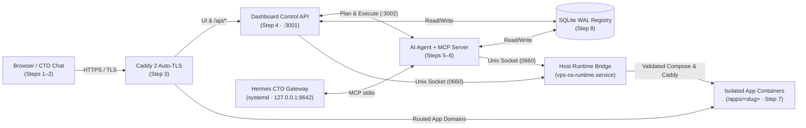

# vps-os-framework

**A plug-and-play, non-Linux-style "VPS OS" framework running on top of Ubuntu Linux VPSs—designed for non-coding and non-Linux users.**

> **Status:** Active TypeScript + pnpm Monorepo (React 19 + Vite + Tailwind v4 Web UI, Hono Control API, Hermes CTO + Vercel AI SDK Agent + MCP Server, Host Runtime Bridge, SQLite WAL Registry, Caddy 2 Auto-TLS, Bash + Docker Compose v2).
>
> **Interactive FigJam Board:** [VPS OS Framework — Architecture & Detailed Model Breakdown](https://www.figma.com/board/ZjpthWRSjpjHnu490klMjP)

---

## Core Vision & Pillars

Instead of managing Ubuntu over SSH, editing Nginx configs, or debugging Docker commands manually, server owners operate their VPS like a modern OS through two core pillars:

1. **Auto-Provisioned Management Dashboard (`dashboard/`):** A browser-based control panel with a 5-step first-boot setup wizard, live server telemetry (CPU, RAM, disk, uptime), workload lifecycle controls (`start` / `stop` / `restart`), secret-redacted logs, and immutable audit history.
2. **Autonomous AI Agent — CTO / Sysadmin / Dev (`agent/`):** A conversational CTO powered by **NousResearch Hermes Agent** and a typed **MCP + Vercel AI SDK toolset** that plans, requests explicit approval for, and deploys isolated web apps and personal-agent sandboxes into separate `/apps/<slug>` folders.

---

## Quick Start

### 1. Provision a Fresh Ubuntu LTS VPS (`22.04` / `24.04`)

```bash
curl -fsSL https://raw.githubusercontent.com/diegosg-dev/vps-os-framework/main/bootstrap/install.sh | sudo bash
```

When installation finishes, open the printed one-click `#claim=XXXX-XXXX-XXXX` URL in your browser to bind a domain (or start in `:80` IP mode), connect your LLM provider (`OpenAI`, `Anthropic`, `OpenRouter`, `Nous Research`, or local `Ollama`), set a memorable passphrase, and run your baseline server scan.

### 2. Local Development & Verification

```bash
corepack pnpm install --frozen-lockfile
corepack pnpm verify   # Builds all packages + Web UI, typechecks, and runs all 29 tests
```

See **[Getting Started, Installation & Onboarding](docs/getting-started.md)** for CLI flags (`--domain`, `--non-interactive`, `--rotate-setup-code`), local dev server instructions, and the host-apply pipeline.

---

## Architecture at a Glance


### System & Trust Topology



| Step / Layer | Components | Responsibility |
|---|---|---|
| **Step 0 & Gates** | `0` Plug-and-Play Bootstrapper, `V` Verification | Idempotent Ubuntu setup (`bootstrap/install.sh`) and automated build/type/safety/bridge tests (`tests/`) |
| **Step 1: Entry Plane** | `1` Management Web UI, `2` Natural-Language CTO Chat | React 19 + Tailwind v4 browser panel for first-boot onboarding, visual metrics, approvals, and CTO requests |
| **Step 2: Ingress & TLS** | `3` Auto-TLS Reverse Proxy | Caddy 2 (`bootstrap/Caddyfile`) for automatic HTTPS termination and dynamic `/vps-os/caddy/apps.d/*.caddy` routing |
| **Step 3: Core & Workloads** | `4` Control API, `5` AI Agent & Hermes CTO, `6` Subagent Runtime, `7` App Containers | Hono API (`dashboard/api`), Hermes + MCP (`agent/`), and host-bridged Docker Compose stacks (`templates/`) |
| **Step 4: State & Storage** | `8` System & App Registry, `9` Per-App Volumes & `.env` Secrets | `node:sqlite` WAL database (`/vps-os/data/registry.db`) and `0600` scoped `.env` + `./data` / `./workspace` mounts |
| **Step 5: Substrate & APIs** | `10` Ubuntu Linux VPS Host + Runtime Bridge, `11` LLM Provider API | Ubuntu/Docker host accessed strictly via `bootstrap/runtime-bridge.py` + external/local LLM reasoning |

---

## Security & "Locked Apartment" Isolation Highlights

- **Zero Docker Socket Exposure:** Core containers (`caddy`, `dashboard-api`, `agent`) run with `cap_drop: ALL`, `no-new-privileges:true`, and **never** mount `/var/run/docker.sock`.
- **TOCTOU-Safe Host Runtime Bridge:** `bootstrap/runtime-bridge.py` (`vps-os-runtime.service`) listens on `/vps-os/run/runtime.sock`, parses a strict YAML subset, verifies `cap_drop: ALL` and `./data` or `./workspace` mount containment, and executes Docker Compose from root-owned `0700` temp copies.
- **Approval-Gated Mutations & Leases:** Mutating CTO actions require an `ExecutionPlan` approved by the owner and claimed with a time-bounded cross-process lease (`claimPlanExecution`).
- **Fail-Closed Auth & Secret Redaction:** One-time SHA-256 setup claim (5-attempt lockout), `scrypt` admin passphrases, HMAC-SHA256 `session_epoch`-scoped sessions, and automatic secret redaction across logs, audit events, plans, and MCP outputs.

---

## Documentation Index

Start at the **[Documentation Hub (`docs/README.md`)](docs/README.md)** for role-based reading paths, or jump directly to a guide:

- **[Getting Started, Installation & Onboarding](docs/getting-started.md)** — Ubuntu LTS one-shot install, CLI options, `#claim=` pairing, 5-step Browser Wizard, and local development/testing.
- **[Architecture Overview & Detailed Model Breakdown](docs/architecture.md)** — Visual diagrams (FigJam exports + Mermaid) and a 5-part breakdown (*Role, Inputs, Internal Mechanics, Outputs, Safety/Stack*) for every layer (`0`–`11` + `V`).
- **[Lifecycle Flows & Real-World Use Cases](docs/flows-and-use-cases.md)** — Walkthroughs and Mermaid diagrams for provisioning, conversational app deployment, live monitoring, and running a **Personal Life Agent container** alongside **separate isolated web apps**.
- **[Runtime Bridge, Isolation & Security Model](docs/runtime-and-security.md)** — Deep dive into socket-less Docker isolation, TOCTOU-safe Compose validation, auth/sessions, SSRF guards, and atomic deployment rollback.
- **[Control API, Agent Protocol, MCP Tools & Registry Reference](docs/api-and-agent-reference.md)** — Complete API endpoints, Runtime Bridge routes, 10 MCP tools, planner risk heuristics, SQLite schema, and environment variables.
- **[Hermes CTO Agent — Architecture, Onboarding & Roadmap](docs/hermes-cto-onboarding.md)** — Hermes CTO pack (`SOUL.md`, bounded `memories/`, progressive `skills/vps-os-*`), `vps-os-mcp` bridge, and upgrade ownership.
- **[Repository Structure & Safety Boundaries](docs/boundaries-and-structure.md)** — Monorepo directory map, confirmed tech stack, secret/host isolation rules, and verification gates.
- **[Templates Guide](templates/README.md)** — Locked Apartment Compose rules for `web-app` and `personal-agent` workloads.
- **[AGENTS.md](AGENTS.md) / [CLAUDE.md](CLAUDE.md)** — Engineering rules and guardrails for AI coding agents.
