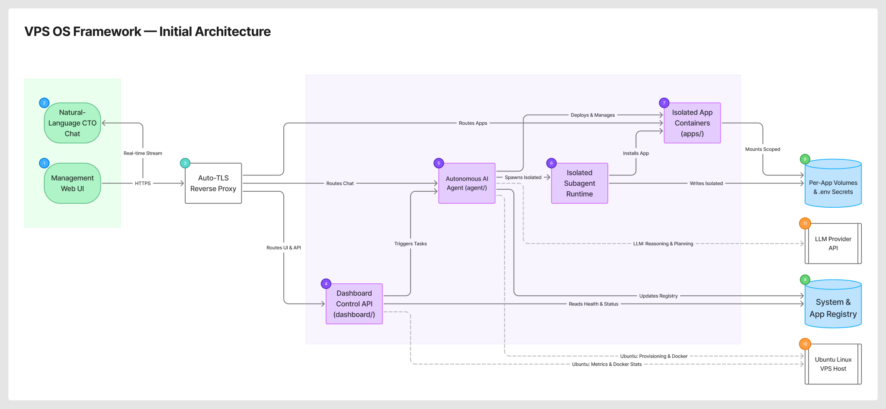

# vps-os-framework

**A plug-and-play, non-Linux-style "VPS OS" framework running on top of Ubuntu Linux VPSs—designed for non-coding and non-Linux users.**

> **Status:** Architecture Foundation Initialized (TypeScript + pnpm monorepo: React/Vite/Tailwind UI, Hono Control API, Vercel AI SDK Agent, SQLite Registry, Caddy Auto-TLS, Bash + Docker Compose v2).
>
> **Interactive FigJam Board:** [VPS OS Framework — Architecture & Detailed Model Breakdown](https://www.figma.com/board/ZjpthWRSjpjHnu490klMjP)

---

## Core Vision & Pillars

Instead of managing Ubuntu over SSH, editing Nginx configs, or debugging Docker commands manually, users operate their server like a modern OS through two core pillars:

1. **Auto-Provisioned Management Dashboard (`dashboard/`):** A browser-based control panel for live server health (CPU, RAM, disk), container status, app logs, domains/TLS, and scoped secrets.
2. **Autonomous AI Agent — CTO / Sysadmin / Dev (`agent/`):** A conversational agent that provisions the server, deploys Docker workloads, builds or installs new apps, and launches isolated subagent or personal-agent environments in dedicated folders—all through natural language.

---

## Architecture at a Glance

| Step / Layer | Components | Responsibility |
|---|---|---|
| **Step 0 & Gates** | `0` Plug-and-Play Bootstrapper, `V` Verification | One-shot Ubuntu setup (`bootstrap/`) and automated shell/Compose/VM checks (`tests/`) |
| **Step 1: Entry Plane** | `1` Management Web UI, `2` Natural-Language CTO Chat | Zero-CLI browser interface for visual control and conversational requests |
| **Step 2: Ingress & TLS** | `3` Auto-TLS Reverse Proxy | Automatic HTTPS termination and routing for UI, chat streams, and apps |
| **Step 3: Core & Workloads** | `4` Control API, `5` AI Agent, `6` Subagent Runtime, `7` App Containers | Orchestrates tasks and runs every app or agent inside isolated folders & containers |
| **Step 4: State & Storage** | `8` System & App Registry, `9` Per-App Volumes & `.env` Secrets | Tracks system state and isolates per-app persistent data and credentials |
| **Step 5: Substrate & APIs** | `10` Ubuntu Linux VPS Host, `11` LLM Provider API | Underlying Ubuntu/Docker compute and external model reasoning |

---

## Documentation Index

- **[Architecture Overview & Detailed Model Breakdown](docs/architecture.md)** — Visual diagrams (FigJam exports + editable Mermaid), plus a 5-part breakdown (*Role, Inputs, Internal Mechanics, Outputs, Safety/Stack*) for every numbered step (`0`–`11` + `V`).
- **[Lifecycle Flows & Real-World Use Cases](docs/flows-and-use-cases.md)** — Plain-language walkthroughs for first-time provisioning, conversational app deployment, live monitoring, and running a **Personal Life Agent container (with full terminal power inside its folder)** alongside **separate isolated app containers**.
- **[Repository Structure & Safety Boundaries](docs/boundaries-and-structure.md)** — Directory map, greenfield stack policy, secret/host isolation rules, and verification gates.
- **[AGENTS.md](AGENTS.md) / [CLAUDE.md](CLAUDE.md)** — Project guardrails and engineering rules for AI coding agents.
