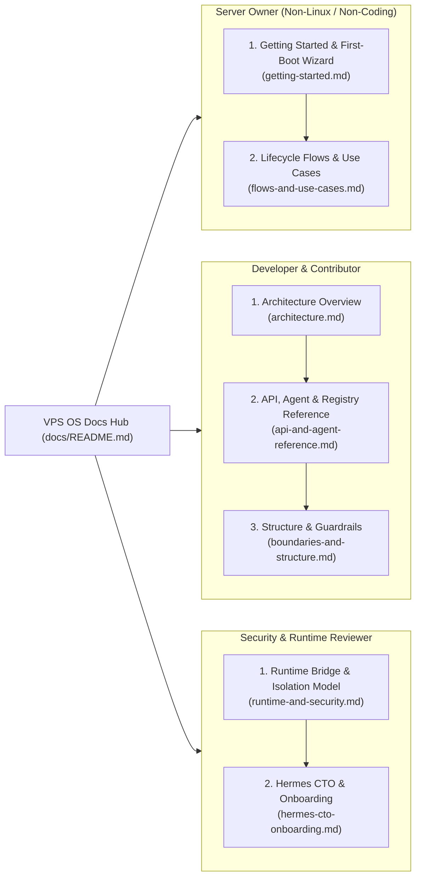
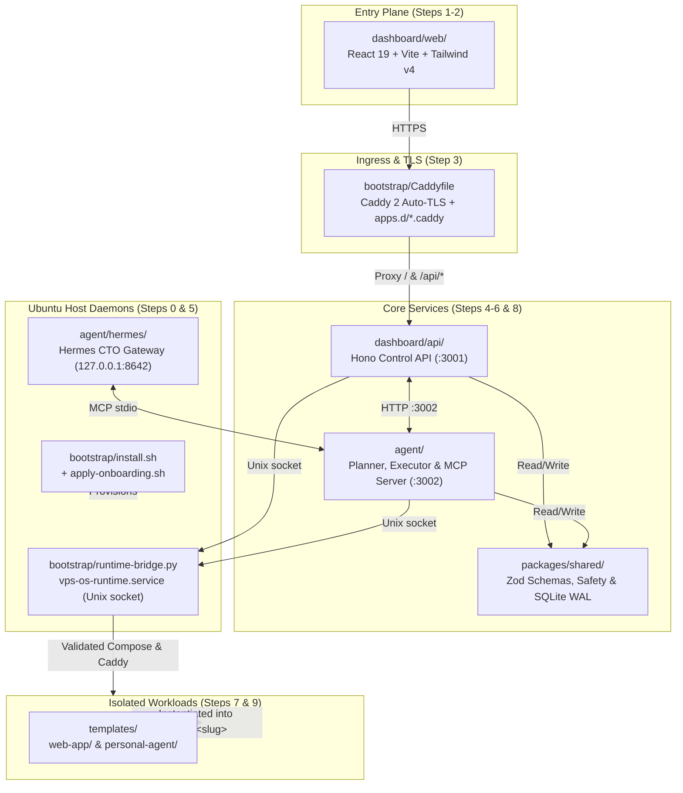

# VPS OS Framework Documentation

Welcome to the **VPS OS Framework** documentation hub. This guide helps server owners, developers, and security reviewers understand how VPS OS turns a bare Ubuntu LTS server into a browser-managed, AI-assisted appliance with strict **"Locked Apartment"** workload isolation.

---

## Choose Your Reading Path

---

## Documentation Catalog

| Document | Audience | What You Will Learn | Key Diagrams & Visuals |
|---|---|---|---|
| **[Getting Started & Onboarding](getting-started.md)** | Owners & Operators | One-shot Ubuntu install, CLI flags, one-time `#claim=` setup code, 5-step Browser Wizard, and local dev/test setup | Bootstrap-to-Wizard flowchart, Host Apply sequence diagram |
| **[Architecture Overview](architecture.md)** | Everyone | Full `0`–`11` + `V` layer breakdown (*Role, Inputs, Mechanics, Outputs, Safety/Stack*) and confirmed tech stack | FigJam PNG exports + editable Mermaid system flow |
| **[Lifecycle Flows & Use Cases](flows-and-use-cases.md)** | Owners & Designers | First-time provisioning, plain-English app deployment, live monitoring, and Personal Life Agent vs. Web App isolation | Provisioning flow, Deploy + Rollback sequence, Locked Apartment topology |
| **[Runtime Bridge & Security](runtime-and-security.md)** | Security & Infra | Socket-less Docker isolation, `vps-os-runtime` Unix socket bridge, TOCTOU-safe Compose validation, auth/sessions, and secret redaction | Trust-boundary graph, Deployment & Rollback state machine |
| **[API, Agent & Registry Reference](api-and-agent-reference.md)** | Developers & Integrators | Hono Control API endpoints, Runtime Bridge API, Agent HTTP & 10 MCP tools, planner heuristics, SQLite schema, and env vars | `ExecutionPlan` & lease state diagram, End-to-end request flow |
| **[Hermes CTO & Onboarding](hermes-cto-onboarding.md)** | CTO / Agent Builders | Hermes Gateway (`systemd`), `SOUL.md`, bounded memory, progressive skills, MCP bridge, and upgrade ownership | Phase 1 topology, Approval-gated MCP sequence, Upgrade ownership graph |
| **[Repository Structure & Boundaries](boundaries-and-structure.md)** | Contributors | Directory map, confirmed stack, secret/host safety rules, verification gates, and Git/PR hygiene | Directory & verification reference tables |

---

## System Layers Mapped to Source Code

---

## Related Governance Files

- **[Project README](../README.md)** — High-level overview, quick start, and architecture summary.
- **[AGENTS.md](../AGENTS.md) / [CLAUDE.md](../CLAUDE.md)** — Guardrails, commands, and PR conventions for AI coding agents.
- **[Templates Guide](../templates/README.md)** — Locked Apartment container rules for `web-app` and `personal-agent` workloads.
