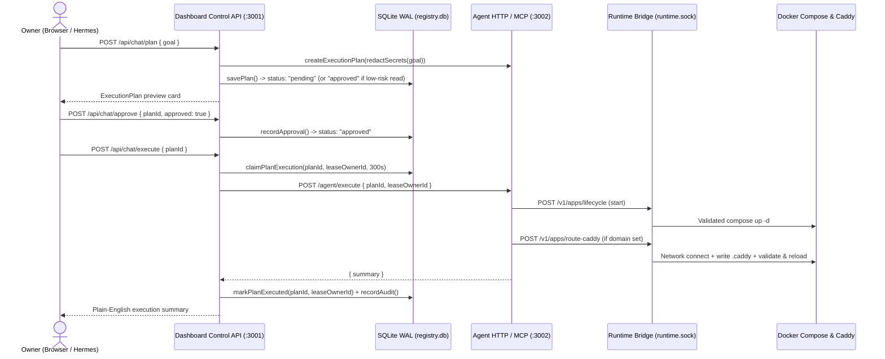
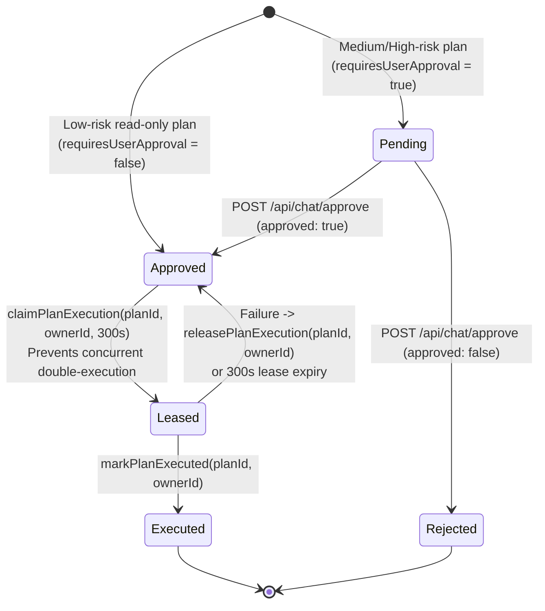

# Control API, Agent Protocol, MCP Tools & Registry Reference

This reference documents every HTTP route, Unix-socket bridge endpoint, MCP JSON-RPC tool, deterministic planner rule, SQLite table, and environment variable in the **VPS OS Framework**.

---

## 1. End-to-End Request & Execution Architecture

---

## 2. Dashboard Control API (`dashboard/api`)

Listens on port `3001` inside `vps-os-dashboard-api` (`HOST=0.0.0.0` in Docker, `127.0.0.1` outside Docker). Authenticated routes accept either `Authorization: Bearer <token>` or `X-VPS-OS-Token: <token>` using either `VPS_OS_ADMIN_TOKEN` or an issued `vpsos_sess_*` token.

### Public & Authentication Routes

| Method & Path | Auth | Request Body / Query | Response / Behavior |
|---|---|---|---|
| `GET /api/health` | Public | — | `{ ok: true, service: "vps-os-dashboard-api", timestamp }` (bypasses rate limit) |
| `GET /api/onboarding/status` | Public | — | `{ onboardingCompleted, currentStep, claimAvailable, passphraseConfigured, authRequired }` |
| `POST /api/auth/claim` | Public | `{ setupCode }` | Consumes one-time setup code (24h TTL, 5-attempt lockout -> `429`), returns `{ ok, token, expiresAt }` |
| `POST /api/auth/login` | Public | `{ passphrase }` or `{ token }` | Verifies `scrypt` passphrase hash or `VPS_OS_ADMIN_TOKEN`, returns HMAC session `{ ok, token, expiresAt }` |

### Onboarding Wizard Routes (Authenticated)

| Method & Path | Request Body | Behavior |
|---|---|---|
| `GET /api/onboarding/state` | — | Returns `{ state, providerCatalog, hermesStatus, hostApplyStatus, passphraseConfigured }` (auto-detects public IP if unset) |
| `POST /api/onboarding/security` | `{ passphrase }` (`10–128` chars) | Stores salted `scrypt` hash, increments `session_epoch` (revoking older sessions), returns fresh session token |
| `POST /api/onboarding/domain` | `{ mode: "domain" \| "ip-only", domain?, acmeEmail? }` | Writes `VPS_OS_DOMAIN` / `VPS_OS_SITE_ADDRESS` to `onboarding.env`, checks DNS if domain mode, triggers host apply |
| `POST /api/onboarding/domain/verify` | `{ domain? }` | Re-checks live DNS `A` records against `publicIp` and updates `dnsVerified` |
| `POST /api/onboarding/provider/test` | `{ provider, model, apiKey?, baseUrl? }` | Tests live provider connectivity (`openai`, `anthropic`, `openrouter`, `nous`, `ollama`) with SSRF URL validation |
| `POST /api/onboarding/provider` | `{ provider, model, apiKey?, baseUrl? }` | Writes provider config/key to `onboarding.env` (`0600`), stages Hermes `config-overrides.json`, triggers host apply |
| `POST /api/onboarding/persona` | `{ ownerName, technicalLevel, communicationStyle, approvalMode, telegramBotToken?, discordBotToken? }` | Stages `USER.md` (`<= 1,375` chars) + approval mode (`manual`/`smart`), stores optional channel tokens in `onboarding.env`, triggers host apply |
| `POST /api/onboarding/baseline-scan` | — | Collects OS, CPU, RAM, disk, app count, and Hermes health; updates `MEMORY.md` (`<= 2,200` chars) and triggers host apply |
| `POST /api/onboarding/complete` | `{ allowWithoutLlm? }` | Invalidates remaining setup claim, marks `completed: true`, triggers host apply (requires LLM unless `allowWithoutLlm: true`) |
| `POST /api/onboarding/reopen` | — | Sets `completed: false`, `currentStep: "domain"` so the owner can revisit setup |

### System, Workloads, Audit & Plan Routes (Authenticated)

| Method & Path | Request / Query | Response / Behavior |
|---|---|---|
| `GET /api/system/metrics` | — | Live `SystemMetrics` (`hostname`, `platform`, `cpuCount`, `loadAverage1m`, `memoryUsedMb`, `memoryTotalMb`, `memoryUsagePercent`, `uptimeSeconds`, `collectedAt`) + `disk` (`fs.statfsSync`) |
| `GET /api/apps` | — | Syncs live statuses via `syncAppStatuses()` (skipping `provisioning` and `cleanup_pending`) and returns `{ apps: AppView[] }` |
| `GET /api/apps/:slug` | — | Syncs and returns `{ app: AppView }` (`400` invalid slug, `404` unknown) |
| `POST /api/apps/:slug/lifecycle` | `{ action: "start" \| "stop" \| "restart" }` | Dispatches action to `WorkloadController` / Runtime Bridge, clears `cleanup_pending`, updates status, logs audit event |
| `GET /api/apps/:slug/logs` | `?tail=1..500` (default `100`) | Fetches container logs via Runtime Bridge and runs `redactSecrets()` on every line |
| `GET /api/audit` | `?limit=1..500` (default `25`) | Returns newest-first immutable `{ events: AuditEvent[] }` |
| `GET /api/chat/plans` | `?status=pending\|approved\|rejected\|executed&limit=1..100` | Lists stored `ExecutionPlan` records |
| `GET /api/chat/plans/:id` | — | Returns `{ plan: StoredPlan }` |
| `POST /api/chat/plan` | `{ goal }` (`1–1000` chars) | Redacts secrets, generates an `ExecutionPlan`, saves to SQLite, records audit event |
| `POST /api/chat/approve` | `{ planId, approved, decidedBy, note? }` | One-way transition from `pending` -> `approved` or `rejected` (`409` if already decided) |
| `POST /api/chat/execute` | `{ planId }` | Claims 300s atomic lease (`dashboard:<uuid>`), delegates to `/agent/execute` (or local executor), marks `executed`, records audit event |

---

## 3. Host Runtime Bridge (`bootstrap/runtime-bridge.py`)

Runs on the Ubuntu host as `vps-os-runtime.service` listening on `/vps-os/run/runtime.sock` (or `--tcp 127.0.0.1:<port>` for local tests). Every `POST` requires `X-VPS-OS-Runtime-Token` (or `Authorization: Bearer`).

| Method & Path | Payload | Behavior |
|---|---|---|
| `GET /health` | — | Unauthenticated health check (`{ ok: true, service: "vps-os-runtime" }`) |
| `POST /v1/apps/lifecycle` | `{ slug, action: "start"\|"stop"\|"restart"\|"status" }` | Validates Compose/env in `0700` temp dir, runs `docker compose -p vps-os-<slug> ...`, derives `running \| stopped \| error` |
| `POST /v1/apps/logs` | `{ slug, tail?: 1..500 }` | Runs `docker compose logs --no-color --tail <tail>`, redacts multi-line secrets, caps lines at `2,000` chars |
| `POST /v1/apps/route-caddy` | `{ slug, domain: string \| null, internalPort }` | Verifies domain uniqueness, connects `vps-os-caddy` to `vps-os-<slug>_app_net`, writes/deletes `<slug>.caddy`, runs `caddy validate` + `caddy reload` with atomic rollback on error |
| `POST /v1/apps/remove` | `{ slug, removeFiles?: boolean }` | Runs `compose down --remove-orphans`, disconnects Caddy network, removes `<slug>.caddy`, optionally deletes `/apps/<slug>` |
| `POST /v1/apps/statuses` | `{ slugs: string[] }` (`<= 100`) | Batch-queries up to 100 workloads via a 4-worker thread pool with an overall `25s` deadline (`504` on timeout) |

---

## 4. Autonomous AI Agent (`agent/`) & MCP Toolset

### Agent HTTP Server (`agent/src/index.ts`, port `3002`)

- `GET /agent/health` — Public inside `vps-os-core` (`{ ok: true, service: "vps-os-agent" }`).
- `POST /agent/plan` *(Bearer/X-VPS-OS-Token)* — Calls `createExecutionPlan(redactSecrets(goal))` and persists the plan.
- `POST /agent/execute` *(Bearer/X-VPS-OS-Token)* — Validates `plan.status === "approved"`, honors caller `leaseOwnerId` or claims its own `agent-http:<uuid>` lease, executes via `executeApprovedPlan()`, and optionally marks `executed`.

### MCP JSON-RPC 2.0 Server (`agent/src/mcp-server.ts`)

Invoked over `stdio` (`docker exec -i vps-os-agent node /srv/vps-os/agent/dist/mcp-server.js`) by Hermes Agent. Supports `initialize` (`2024-11-05`), `ping`, `tools/list`, and `tools/call`, recursively redacting all string leaves (`redactJsonValue`) before writing JSON responses.

| Tool Name | Mode | Inputs | Responsibility & Guardrails |
|---|---|---|---|
| `inspect_apps` | Read-only | `{}` | Syncs live container statuses via Runtime Bridge and returns registered apps |
| `list_audit_events` | Read-only | `{ limit?: 1..100 }` | Lists recent secret-redacted audit events |
| `read_app_logs` | Read-only | `{ slug, tail?: 1..500 }` | Fetches secret-redacted container logs via Runtime Bridge |
| `propose_plan` | Low-impact write | `{ goal }` | Redacts secrets, classifies risk, and saves an `ExecutionPlan` (`pending` unless read-only) |
| `get_plan_status` | Read-only | `{ planId }` | Checks current approval/execution state of a stored plan |
| `prepare_app_workspace` | **Approval-gated** | `{ planId, slug, name, kind, domain, internalPort? }` | Claims lease, provisions `/apps/<slug>` + `docker-compose.yml` + `0600` `.env` + `provisioning` DB row, marks plan `executed` |
| `deploy_workload` | **Approval-gated** | `{ planId, slug, name, kind, domain, internalPort? }` | End-to-end deploy: provisions workspace, starts container, binds Caddy route (if domain), or rolls back cleanly on failure |
| `control_app_lifecycle` | **Approval-gated** | `{ planId, slug, action }` | Runs `start` / `stop` / `restart` via Runtime Bridge and updates registry + audit log |
| `configure_app_domain` | **Approval-gated** | `{ planId, slug, domain }` | Binds or removes Caddy Auto-TLS route for an existing app and updates `apps.domain` |
| `update_app_status` | State sync | `{ slug, status, summary? }` | Updates `apps.status` (`provisioning \| running \| stopped \| error`) and records an audit event |

---

## 5. Planner Risk Heuristics & ExecutionPlan Lease Lifecycle

[`agent/src/planner.ts`](../agent/src/planner.ts) uses a **fail-closed** classifier (`classifyGoalRisk`):
- **`high`:** Matches `delete|remove|destroy|reset|wipe|erase|format|firewall|ufw|ssh|sudo|root|secret|token|password|key|\.env|deploy|install|create|provision|exec|shell`.
- **`low`:** Starts with `check|status|list|show|inspect|get|view|health|metrics|describe|read` and contains no mutation keywords (`requiresUserApproval: false`).
- **`medium`:** Anything else (`requiresUserApproval: true`).

For mutations, `createExecutionPlan()` routes into one of three deterministic templates:
1. **Lifecycle intent (`LIFECYCLE_INTENT_PATTERN`):** e.g., `"restart analytics"` -> `inspect_apps` + `control_app_lifecycle`.
2. **Workload deploy (`extractDeploySpecFromGoal`):** Extracts `slug`, `kind` (`personal-agent` vs. `web-app`), `domain` (for `web-app` only, skipping file extensions), and `internalPort` (`80` for `web-app`, `3000` default for `personal-agent`) -> `inspect_apps` + `prepare_app_workspace` + `update_app_status`.
3. **Ambiguous / Host-level request:** Falls back to `manual_review` (blocked from automated execution with HTTP `422`).

---

## 6. SQLite System & App Registry Schema (`packages/shared/src/store.ts`)

Stored in `/vps-os/data/registry.db` using Node's built-in `node:sqlite` (`PRAGMA journal_mode = WAL; busy_timeout = 5000; foreign_keys = ON;`).

| Table | Primary Key | Purpose & Key Columns |
|---|---|---|
| `apps` | `slug` | Registered workloads: `name`, `kind` (`web-app \| personal-agent`), `domain` (unique case-insensitive index), `folder_path`, `internal_port`, `status`, `cpu_limit`, `memory_limit_mb`, `cleanup_pending`, `created_at`, `updated_at` |
| `audit_events` | `id` | Immutable, redacted audit log (`idx_audit_created_at DESC`): `actor` (`user \| agent \| system`), `action`, `target_slug`, `summary` (`<= 500` chars), `risk_level`, `created_at` |
| `execution_plans` | `id` | Plans & leases: `goal`, `summary`, `steps_json`, `requires_user_approval`, `status`, `decided_by`, `decision_note`, `created_at`, `decided_at`, `execution_owner`, `execution_started_at`, `execution_expires_at` |
| `system_settings` | `key` | Key-value JSON settings: `onboarding_state`, `admin_passphrase_hash` (`scrypt`), and monotonic `session_epoch` |

---

## 7. Environment Variables Reference

| Variable | Where Defined | Purpose |
|---|---|---|
| `VPS_OS_DOMAIN` / `VPS_OS_SITE_ADDRESS` | `/vps-os/.env` | Public dashboard domain and Caddy site address (`:80` in IP setup mode, `localhost` locally) |
| `VPS_OS_ACME_EMAIL` | `/vps-os/.env` | Email used by Caddy for ACME / Let's Encrypt certificate alerts |
| `VPS_OS_PUBLIC_IP` | `/vps-os/.env` | Detected public IPv4 used by the DNS verification step |
| `VPS_OS_ADMIN_TOKEN` | `/vps-os/.env` | Root bearer/signing secret (`>= 16` chars) shared between `dashboard-api` and `agent` |
| `VPS_OS_RUNTIME_TOKEN` | `/vps-os/.env` & `/vps-os/runtime-bridge.env` | Dedicated token (`>= 16` chars) authenticating requests over `/vps-os/run/runtime.sock` |
| `VPS_OS_RUNTIME_SOCKET` / `VPS_OS_RUNTIME_URL` | Core Compose / local dev | Path to `runtime.sock` (`/run/vps-os/runtime.sock` in containers) or loopback `http://127.0.0.1:...` |
| `VPS_OS_REGISTRY_DB` | Core Compose | Path to SQLite WAL database (`/data/registry.db` in containers) |
| `VPS_OS_APPS_ROOT` / `VPS_OS_TEMPLATES_ROOT` | Core Compose | `/apps` and `/srv/vps-os/templates` |
| `VPS_OS_AGENT_URL` / `VPS_OS_TRUST_PROXY` | `dashboard-api` | Internal URL `http://agent:3002`; set `VPS_OS_TRUST_PROXY=true` only behind a trusted reverse proxy |
| `LLM_PROVIDER` / `LLM_MODEL` / `LLM_API_KEY` / `LLM_BASE_URL` | `/vps-os/.env` | CTO LLM configuration (`openai`, `anthropic`, `openrouter`, `nous`, `ollama`) |
| `HERMES_HOME` / `HERMES_API_SERVER_KEY` | `/vps-os/.env` | Hermes host directory (`/vps-os/hermes`) and local API server key |
| `HERMES_GATEWAY_URL` | Core Compose default | Internal URL from `dashboard-api` to host Hermes Gateway (`http://host.docker.internal:8642`) |
| `TELEGRAM_BOT_TOKEN` / `DISCORD_BOT_TOKEN` | `/vps-os/.env` | Optional chat channel tokens applied via `onboarding.env` |

> **Container-internal overrides:** Core Compose and unit files also pass or support `PORT`, `HOST`, `CORE_NETWORK`, `VPS_OS_DATA_DIR`, `VPS_OS_ONBOARDING_ENV_FILE`, `VPS_OS_SETUP_CLAIM_FILE`, `VPS_OS_HERMES_HOME`, `VPS_OS_WEB_DIST`, `VPS_OS_CADDY_APPS_DIR`, `VPS_OS_CADDY_CONTAINER`, `VPS_OS_DOCKER_BIN`, and `VPS_OS_STATUS_DEADLINE_S`.
