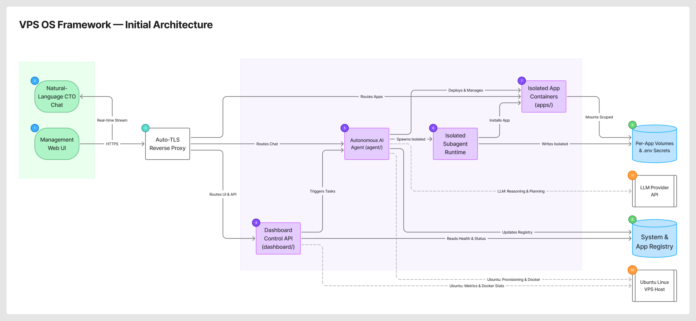
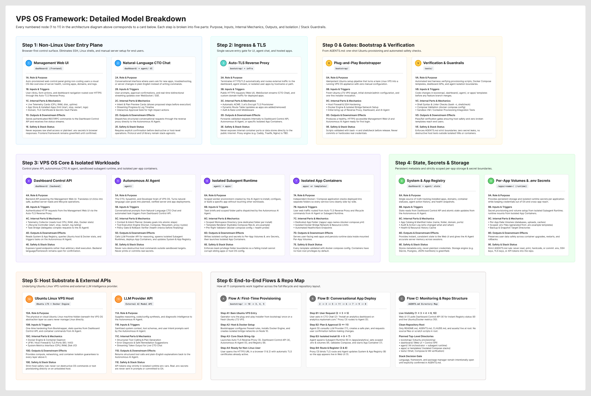
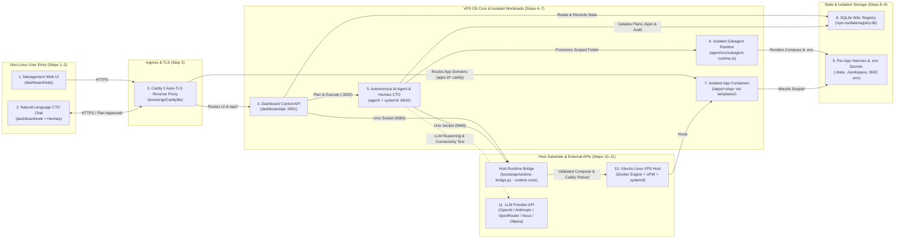

# Architecture Overview & Detailed Model Breakdown

The **VPS OS Framework** turns a standard Ubuntu Linux VPS into a plug-and-play, non-Linux-style server operating environment for non-coding and non-Linux users. Every component is designed around two core pillars—an **Auto-Provisioned Management Dashboard** and an **Autonomous AI Agent (CTO / Sysadmin / Dev)**—backed by strict folder and container isolation without ever exposing `/var/run/docker.sock` to containers.

> **Interactive FigJam Board:** [VPS OS Framework — Architecture & Detailed Model Breakdown](https://www.figma.com/board/ZjpthWRSjpjHnu490klMjP)

---

## Visual Architecture

### System Flow Diagram (`0`–`11`)

### Complete Layer & Component Breakdown

### Editable Mermaid Source

---

## Step-by-Step Component Reference

Every numbered badge (`1`–`11`) in the diagram above—along with Step `0` (Bootstrap) and Gate `V` (Verification)—is broken down into five parts: **Role & Purpose**, **Inputs & Triggers**, **Internal Parts & Mechanics**, **Outputs & Downstream Effects**, and **Safety & Implementation**.

---

### Step 0 & Gates: Bootstrap & Verification

#### `0` — Plug-and-Play Bootstrapper (`bootstrap/`)

- **0A. Role & Purpose:** Idempotent Ubuntu LTS setup pipeline that turns a bare Linux VPS into a running VPS OS appliance with zero manual configuration.
- **0B. Inputs & Triggers:** Fresh Ubuntu 22.04/24.04 LTS VPS target, optional CLI flags (`--domain`, `--email`, `--llm-provider`, `--non-interactive`, `--rotate-setup-code`, `--force`), and one-line installer invocation.
- **0C. Internal Parts & Mechanics:**
  - SSH key-guarded hardening (`99-vps-os-hardening.conf` only when authorized SSH keys exist) & `ufw` firewall (`SSH`, `80/tcp`, `443/tcp`)
  - Docker Engine + Compose v2 & Python 3 installation + isolated `vps-os-core` bridge network
  - Secret generation (`VPS_OS_ADMIN_TOKEN`, `VPS_OS_RUNTIME_TOKEN`, `HERMES_API_SERVER_KEY`) and single-use SHA-256 setup pairing code (`/vps-os/data/setup-claim.json`)
  - Bring-up of `vps-os-runtime.service`, core Docker stack (`caddy`, `dashboard-api`, `agent`), `vps-os-hermes-cto.service`, and `vps-os-onboarding-apply.path`
- **0D. Outputs & Downstream Effects:** Produces a healthy Management Web UI (`1`) with a one-click `#claim=` setup URL and an Autonomous AI Agent (`5`) ready for onboarding.
- **0E. Safety & Implementation:** Implemented in [`bootstrap/install.sh`](../bootstrap/install.sh) and [`bootstrap/apply-onboarding.sh`](../bootstrap/apply-onboarding.sh); validated with `bash -n` and LF line-ending guardrails in `tests/`.

#### `V` — Verification & Guardrails (`tests/`)

- **VA. Role & Purpose:** Automated test suite verifying provisioning scripts, Docker Compose templates, Host Runtime Bridge isolation, Dashboard Control APIs, onboarding flows, and agent boundaries.
- **VB. Inputs & Triggers:** `corepack pnpm verify` (`build && typecheck && test`) run before any branch merges.
- **VC. Internal Parts & Mechanics:**
  - TypeScript build & strict `tsc --noEmit` checks across all workspace packages
  - Node built-in test runner (`tests/src/*.test.ts`) covering safety guards, SQLite registry, Control API auth/rate-limiting, onboarding claim lockouts, Hermes pack limits, and `runtime-bridge.py` TOCTOU/Compose policies
  - Shell syntax (`bash -n`), Python AST validation, and LF line-ending assertions
- **VD. Outputs & Downstream Effects:** Pass/fail verification gates ensuring host safety and zero broken templates or security regressions.
- **VE. Safety & Implementation:** Implemented in [`tests/src/`](../tests/src/); all tests run in isolated temp directories or loopback mocks with zero destructive host side effects.

---

### Step 1: Non-Linux User Entry Plane

#### `1` — Management Web UI (`dashboard/web/`)

- **1A. Role & Purpose:** Auto-provisioned web control panel giving non-coding users a visual OS-like overview of onboarding, server health, running apps, domains, logs, and audit history.
- **1B. Inputs & Triggers:** Browser requests routed over HTTPS (or initial `:80` setup mode) through Caddy (`3`), plus `#claim=` one-click pairing URLs.
- **1C. Internal Parts & Mechanics:**
  - `AuthGate.tsx`: One-time Setup Code claim, Admin Passphrase login, or `VPS_OS_ADMIN_TOKEN` unlock
  - `OnboardingWizard.tsx`: 5-step guided setup (`Domain & HTTPS`, `AI CTO Brain`, `Security & CTO`, `Baseline Scan`, `Launch`)
  - `App.tsx`: Live telemetry cards (CPU, load, RAM, disk, uptime), Installed Workloads grid (`Start`, `Stop`, `Restart`, `View Logs`), Audit timeline, and CTO Plan preview/approval cards
- **1D. Outputs & Downstream Effects:** Sends authenticated `Bearer` REST requests to the Dashboard Control API (`4`).
- **1E. Safety & Implementation:** Built with **React 19 + Vite + Tailwind CSS v4** (`dashboard/web/`), served with a strict `Content-Security-Policy` and `X-Frame-Options: DENY`.

#### `2` — Natural-Language CTO Chat (`dashboard/web/` + `agent/`)

- **2A. Role & Purpose:** Conversational interface where users request new apps, personal agents, lifecycle actions, or diagnostics in plain English instead of writing Linux commands.
- **2B. Inputs & Triggers:** User goals submitted in the CTO Plan console (`POST /api/chat/plan`), interactive plan approvals (`POST /api/chat/approve`), and Hermes Gateway sessions (`127.0.0.1:8642`).
- **2C. Internal Parts & Mechanics:**
  - Intent & Risk Plan Preview Cards showing every planned step before mutation (`ExecutionPlan`)
  - One-way Approval Gate (`pending` -> `approved` / `rejected`) and execution trigger (`POST /api/chat/execute`)
  - Plain-English execution summaries with redacted logs and audit trail records
- **2D. Outputs & Downstream Effects:** Dispatches structured goals and approved plans through the Control API (`4`) to the Autonomous AI Agent (`5`).
- **2E. Safety & Implementation:** Fail-closed risk classification (`agent/src/planner.ts`); ambiguous or destructive host requests route to `manual_review` and are blocked from automated execution.

---

### Step 2: Ingress & TLS

#### `3` — Auto-TLS Reverse Proxy (`bootstrap/Caddyfile`)

- **3A. Role & Purpose:** Terminates HTTPS/TLS automatically and routes external traffic to the dashboard or isolated user web apps by hostname.
- **3B. Inputs & Triggers:** Public HTTP/HTTPS requests (`80`/`443`) and dynamic per-app `.caddy` files written by `vps-os-runtime` under `/vps-os/caddy/apps.d/*.caddy`.
- **3C. Internal Parts & Mechanics:**
  - Automatic ACME / Let's Encrypt TLS provisioning (`VPS_OS_ACME_EMAIL`) and `zstd`/`gzip` compression
  - Primary site block (`{$VPS_OS_SITE_ADDRESS:localhost}`) proxying `/` and `/api/*` to `dashboard-api:3001`
  - Dynamic import of `/etc/caddy/apps.d/*.caddy` validated via `caddy validate` before every `caddy reload`
- **3D. Outputs & Downstream Effects:** Forwards validated requests internally to Dashboard Control API (`4`) or connected `vps-os-app-<slug>` containers (`7`).
- **3E. Safety & Implementation:** Implemented with **Caddy 2 (`caddy:2-alpine`)** dropping all capabilities except `NET_BIND_SERVICE`. Never proxies `/agent/*` or `127.0.0.1:8642` publicly.

---

### Step 3: VPS OS Core & Isolated Workloads

#### `4` — Dashboard Control API (`dashboard/api/`)

- **4A. Role & Purpose:** Backend API powering the Management Web UI (`1`). Translates UI actions into authenticated, rate-limited telemetry reads, onboarding updates, plan approvals, and runtime bridge commands.
- **4B. Inputs & Triggers:** Authenticated HTTP requests from the Management Web UI (`1`) via Caddy (`3`).
- **4C. Internal Parts & Mechanics:**
  - Telemetry Collector (`metrics.ts`): Reads CPU, load, Linux `MemAvailable`, uptime, and root disk usage via `node:os` / `fs.statfsSync` without shell calls
  - Onboarding & Auth Engine (`onboarding.ts`, `onboarding-routes.ts`): Manages one-time claims, `scrypt` passphrases, HMAC session tokens (`vpsos_sess_*`), DNS verification, live LLM tests, and host-apply triggers
  - Workload & Plan Controller (`app.ts`, `runtime.ts`): Syncs container statuses, triggers `start`/`stop`/`restart`/redacted `logs` over `runtime.sock`, and claims cross-process execution leases before calling `/agent/execute`
- **4D. Outputs & Downstream Effects:** Reads/writes System & App Registry (`8`), communicates with `vps-os-agent` (`5`), and invokes `vps-os-runtime` (`10`).
- **4E. Safety & Implementation:** Built with **TypeScript + Hono (`@hono/node-server`)**. Enforces fail-closed auth, sliding-window rate limits, `64 KiB` body limits, security headers, and secret redaction.

#### `5` — Autonomous AI Agent (`agent/` + Hermes CTO Gateway)

- **5A. Role & Purpose:** The CTO, Sysadmin, and Developer brain of VPS OS. Turns natural-language goals into planned, approval-gated server and app deployments. Pairs **NousResearch Hermes Agent** (`vps-os-hermes-cto.service` on the host) with the typed **VPS OS MCP & HTTP Agent Runtime** (`agent/`).
- **5B. Inputs & Triggers:** HTTP requests from `dashboard-api` (`POST /agent/plan`, `POST /agent/execute`), MCP `stdio` JSON-RPC calls from Hermes (`agent/src/mcp-server.ts`), and scheduled Hermes `cronjob` routines.
- **5C. Internal Parts & Mechanics:**
  - Identity & Bounded Memory (`agent/hermes/SOUL.md`, `MEMORY.md` `<= 2,200` chars, `USER.md` `<= 1,375` chars, SQLite `FTS5`)
  - Progressive-Disclosure CTO Skills (`agent/hermes/skills/vps-os-*/SKILL.md` + learned skills)
  - Deterministic Planner & Executor (`planner.ts`, `executor.ts`) + **10 typed Zod/MCP tools** (`tools.ts`): `inspect_apps`, `list_audit_events`, `read_app_logs`, `propose_plan`, `get_plan_status`, `prepare_app_workspace`, `deploy_workload`, `control_app_lifecycle`, `configure_app_domain`, `update_app_status`
- **5D. Outputs & Downstream Effects:** Consults LLM Provider API (`11`), invokes Isolated Subagent Runtime (`6`), coordinates `vps-os-runtime` (`10`) for Docker/Caddy changes, and updates System & App Registry (`8`).
- **5E. Safety & Implementation:** Built with **TypeScript + Vercel AI SDK (`ai`) + Zod**. Enforces one-time plan approval, 300s cross-process execution leases, automatic deployment rollback, and recursive JSON secret redaction.

#### `6` — Isolated Subagent Runtime (`agent/src/subagent-runtime.ts`)

- **6A. Role & Purpose:** Scoped workspace provisioner invoked by the AI Agent (`5`) to initialize a new app or personal-agent folder under `/apps/<slug>` without touching sibling workloads.
- **6B. Inputs & Triggers:** Approved deployment specs (`slug`, `name`, `kind`, `domain`, `internalPort`) from `executeApprovedPlan` or MCP tools.
- **6C. Internal Parts & Mechanics:**
  - Path Containment (`resolveScopedAppDir`): Rejects reserved slugs, traversal, and symlinks
  - Template Hydration: Copies `templates/web-app` or `templates/personal-agent`, sets `APP_SLUG`/`APP_PORT`, writes starter `index.html` (for `web-app`), and creates `0600` `.env` + `.env.example`
  - Registry Registration: Upserts `AppRecord` with `status: "provisioning"` and records an audit event, rolling back directory creation on any write error
- **6D. Outputs & Downstream Effects:** Writes isolated configs to `/apps/<slug>/` (`9`) ready for `vps-os-runtime` to validate and launch (`7`).
- **6E. Safety & Implementation:** Never overwrites existing `/apps/<slug>` workspaces and never writes plaintext secrets into `.env.example` or `docker-compose.yml`.

#### `7` — Isolated App Containers (`templates/` -> `/apps/<slug>`)

- **7A. Role & Purpose:** Independent Docker Compose v2 stacks deployed into separate `/apps/<slug>` folders so web apps and personal agents run side-by-side without interfering with each other.
- **7B. Inputs & Triggers:** Public HTTPS traffic routed by Caddy (`3`) for `web-app` workloads, and lifecycle/status commands from `vps-os-runtime` (`10`).
- **7C. Internal Parts & Mechanics:**
  - Built-in templates: [`templates/web-app/docker-compose.yml`](../templates/web-app/docker-compose.yml) (`0.5` CPU, `512m` RAM, port `80`) and [`templates/personal-agent/docker-compose.yml`](../templates/personal-agent/docker-compose.yml) (`1.0` CPU, `1024m` RAM, `node:24-bookworm-slim` with `/workspace`)
  - Isolated per-app `app_net` bridge network (`vps-os-<slug>_app_net`)
  - Mandatory `cap_drop: [ALL]`, `security_opt: [no-new-privileges:true]`, and container healthchecks
- **7D. Outputs & Downstream Effects:** Serves web apps or runs autonomous agent scripts inside mounted Per-App Volumes (`9`).
- **7E. Safety & Implementation:** Every Compose file is structurally validated by `bootstrap/runtime-bridge.py` before execution; `/var/run/docker.sock` and host root mounts are strictly rejected.

---

### Step 4: State, Secrets & Storage

#### `8` — System & App Registry (`packages/shared/src/store.ts`)

- **8A. Role & Purpose:** Single source of truth tracking registered workloads, domains, execution plans + cross-process leases, audit events, and onboarding/auth settings.
- **8B. Inputs & Triggers:** Concurrent reads and atomic writes from Dashboard Control API (`4`) and Autonomous AI Agent (`5`).
- **8C. Internal Parts & Mechanics:**
  - `apps` table (with unique case-insensitive `domain` index and `cleanup_pending` flag)
  - `audit_events` table (immutable redacted trail)
  - `execution_plans` table (`pending | approved | rejected | executed` + `execution_owner`/`execution_expires_at` leases)
  - `system_settings` table (`onboarding_state`, `admin_passphrase_hash`, `session_epoch`)
- **8D. Outputs & Downstream Effects:** Delivers consistent state to the Web UI (`1`) and gives the AI Agent (`5`) durable cross-session memory.
- **8E. Safety & Implementation:** Built with Node's built-in **`node:sqlite` in WAL mode** (`PRAGMA busy_timeout = 5000`). Stores metadata and `scrypt` hashes only—never plaintext API keys or `.env` secrets.

#### `9` — Per-App Volumes & `.env` Secrets (`/apps/<slug>/`)

- **9A. Role & Purpose:** Provides persistent storage and isolated runtime secrets per application while keeping credentials out of Git and sibling containers.
- **9B. Inputs & Triggers:** Workspace provisioning from Subagent Runtime (`6`) and runtime mounts from Isolated App Containers (`7`).
- **9C. Internal Parts & Mechanics:**
  - Persistent directories: `./data` (for `web-app`) or `./workspace` (for `personal-agent`)
  - Scoped `.env` (`chmod 0600`) validated against disallowed host/Docker variable prefixes (`VPS_OS_`, `DOCKER_`, `LD_`)
- **9D. Outputs & Downstream Effects:** Preserves app data and credentials safely across container upgrades, restarts, and rollbacks.
- **9E. Safety & Implementation:** Symlinks and `..` escapes in volume paths are blocked at both Node (`safety.ts`) and Python (`runtime-bridge.py`) boundaries.

---

### Step 5: Host Substrate & External APIs

#### `10` — Ubuntu Linux VPS Host & Runtime Bridge (`bootstrap/runtime-bridge.py`)

- **10A. Role & Purpose:** The underlying Ubuntu LTS machine and Docker Engine, insulated from containers by the narrow `vps-os-runtime.service` Unix socket bridge.
- **10B. Inputs & Triggers:** Host hardening from Bootstrapper (`0`), onboarding sync triggers via `vps-os-onboarding-apply.path`, and authenticated JSON requests over `/vps-os/run/runtime.sock`.
- **10C. Internal Parts & Mechanics:**
  - `vps-os-runtime.service`: Sandboxed `systemd` daemon (`ProtectSystem=strict`, `ProtectHome=true`, `PrivateDevices=true`) running `runtime-bridge.py`
  - TOCTOU-safe Compose validator (`O_NOFOLLOW` + root-owned `0700` temp dir) + sanitized Docker subprocess env
  - Atomic Caddy route writer (`/vps-os/caddy/apps.d/<slug>.caddy`) + `caddy validate` / `caddy reload`
- **10D. Outputs & Downstream Effects:** Executes approved container lifecycle, routing, and cleanup operations safely without giving any container Docker socket access.
- **10E. Safety & Implementation:** Strictly allowlisted endpoints (`/health`, `/v1/apps/lifecycle`, `/v1/apps/logs`, `/v1/apps/route-caddy`, `/v1/apps/remove`, `/v1/apps/statuses`); rejects unauthenticated or malformed requests.

#### `11` — LLM Provider API (`OpenAI` / `Anthropic` / `OpenRouter` / `Nous` / `Ollama`)

- **11A. Role & Purpose:** Supplies reasoning, diagnostics, and plain-English planning to the Autonomous AI Agent (`5`).
- **11B. Inputs & Triggers:** Sanitized context, MCP tool schemas, and prompts from Hermes CTO (`5`), plus live connectivity checks from Step 2 of the Onboarding Wizard (`POST /api/onboarding/provider/test`).
- **11C. Internal Parts & Mechanics:**
  - Supports `openai`, `anthropic`, `openrouter`, `nous`, and self-hosted `ollama` (`LLM_BASE_URL` validated against SSRF metadata targets)
  - Structured tool-calling through Hermes MCP (`vps-os-mcp`)
- **11D. Outputs & Downstream Effects:** Returns structured tool calls and plain-English responses back to the CTO Agent (`5`).
- **11E. Safety & Implementation:** Provider keys are stored only in `0600` `/vps-os/.env` (staged via `/vps-os/config/onboarding.env`), never in SQLite and never returned to the browser.
