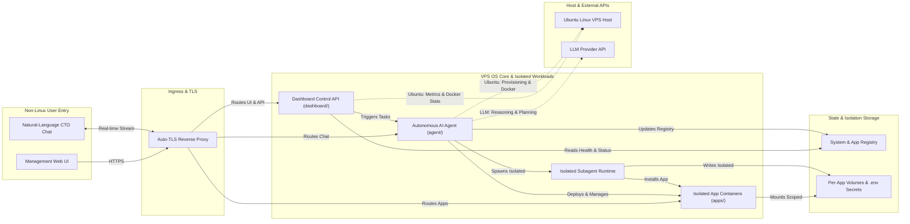

# Architecture Overview & Detailed Model Breakdown

The **VPS OS Framework** turns a standard Ubuntu Linux VPS into a plug-and-play, non-Linux-style server operating environment for non-coding and non-Linux users. Every component is designed around two core pillars—an **Auto-Provisioned Management Dashboard** and an **Autonomous AI Agent (CTO / Sysadmin / Dev)**—backed by strict folder and container isolation.

> **Interactive FigJam Board:** [VPS OS Framework — Architecture & Detailed Model Breakdown](https://www.figma.com/board/ZjpthWRSjpjHnu490klMjP)

---

## Visual Architecture

### System Flow Diagram (`0`–`11`)

### Complete Layer & Component Breakdown

### Editable Mermaid Source

---

## Step-by-Step Component Reference

Every numbered badge (`1`–`11`) in the diagram above—along with Step `0` (Bootstrap) and Gate `V` (Verification)—is broken down into five parts: **Role & Purpose**, **Inputs & Triggers**, **Internal Parts & Mechanics**, **Outputs & Downstream Effects**, and **Safety & Stack Status**.

---

### Step 0 & Gates: Bootstrap & Verification

#### `0` — Plug-and-Play Bootstrapper (`bootstrap/`)

- **0A. Role & Purpose:** Idempotent Ubuntu setup pipeline that turns a bare Linux VPS into a running VPS OS appliance with zero manual configuration.
- **0B. Inputs & Triggers:** Fresh Ubuntu LTS VPS target, initial domain/admin configuration, and one-line installer invocation.
- **0C. Internal Parts & Mechanics:**
  - Host Firewall & SSH Hardening
  - Docker Engine & Isolated Bridge Network Setup
  - Initial bring-up of Reverse Proxy (`3`), Dashboard (`4`), and AI Agent (`5`)
- **0D. Outputs & Downstream Effects:** Produces a healthy, HTTPS-accessible Management Web UI (`1`) and Autonomous AI Agent (`5`) ready for first login.
- **0E. Safety & Stack Status:** Shell scripts must pass `bash -n` and `shellcheck` before release. Never commits or hardcodes real credentials.

#### `V` — Verification & Guardrails (`tests/`)

- **VA. Role & Purpose:** Automated test harness verifying provisioning scripts, Docker Compose templates, dashboard APIs, and agent isolation boundaries.
- **VB. Inputs & Triggers:** Code changes in `bootstrap/`, `dashboard/`, `agent/`, or `apps/` templates before any feature branch merges.
- **VC. Internal Parts & Mechanics:**
  - Shell Syntax & Linter Checks (`bash -n`, `shellcheck`)
  - Compose Validation (`docker compose config`)
  - Sandbox VM / Container Provisioning Integration Tests
- **VD. Outputs & Downstream Effects:** Pass/fail verification gates ensuring host safety and zero broken templates reach end users.
- **VE. Safety & Stack Status:** Enforces strict boundaries: zero secret leaks, no destructive host tests outside isolated VMs or containers.

---

### Step 1: Non-Linux User Entry Plane

#### `1` — Management Web UI (`dashboard/` frontend)

- **1A. Role & Purpose:** Auto-provisioned web control panel giving non-coding users a visual OS-like overview of server health, running apps, domains, and logs.
- **1B. Inputs & Triggers:** User clicks, form actions, and dashboard navigation routed over HTTPS through the Auto-TLS Reverse Proxy (`3`).
- **1C. Internal Parts & Mechanics:**
  - Live Telemetry Cards (CPU, RAM, disk, uptime)
  - App Store & Installed Apps Grid (start, stop, restart, logs)
  - Domain, TLS Certificate & Secrets Vault Panels
- **1D. Outputs & Downstream Effects:** Sends authenticated REST/RPC commands to the Dashboard Control API (`4`) and receives live status streams.
- **1E. Safety & Stack Status:** Never exposes raw shell access or plaintext `.env` secrets in browser responses. Frontend framework remains greenfield until explicitly confirmed.

#### `2` — Natural-Language CTO Chat (`dashboard/` + `agent/` UI)

- **2A. Role & Purpose:** Conversational interface where users ask for new apps, troubleshooting, or server changes in plain English instead of writing Linux commands.
- **2B. Inputs & Triggers:** User prompts, approval confirmations, and real-time bidirectional streaming updates over WebSocket / SSE.
- **2C. Internal Parts & Mechanics:**
  - Intent & Plan Preview Cards (shows proposed steps before execution)
  - Streaming Progress & Log Timeline
  - Interactive Approval Gate for high-impact actions
- **2D. Outputs & Downstream Effects:** Dispatches structured conversational requests through the reverse proxy (`3`) directly to the Autonomous AI Agent (`5`).
- **2E. Safety & Stack Status:** Requires explicit user confirmation before destructive or host-level operations. Protocol and UI library remain stack-agnostic.

---

### Step 2: Ingress & TLS

#### `3` — Auto-TLS Reverse Proxy (`bootstrap/` + infra)

- **3A. Role & Purpose:** Terminates HTTPS/TLS automatically and routes external traffic to the dashboard, agent stream, or isolated user apps by hostname or path.
- **3B. Inputs & Triggers:** Public HTTPS requests (Web UI), WebSocket streams (CTO Chat), and custom domain traffic for deployed apps.
- **3C. Internal Parts & Mechanics:**
  - Automatic ACME / Let's Encrypt TLS Provisioner
  - Dynamic Route Table (updates as apps are added or removed)
  - Auth & Rate-Limit Middleware
- **3D. Outputs & Downstream Effects:** Forwards validated requests internally to Dashboard Control API (`4`), Autonomous AI Agent (`5`), or specific Isolated App Containers (`7`).
- **3E. Safety & Stack Status:** Never exposes internal container ports or data stores directly to the public internet. Proxy engine (e.g., Caddy, Traefik, Nginx) is undecided.

---

### Step 3: VPS OS Core & Isolated Workloads

#### `4` — Dashboard Control API (`dashboard/` backend)

- **4A. Role & Purpose:** Backend API powering the Management Web UI (`1`). Translates UI clicks into safe, audited server reads and lifecycle operations.
- **4B. Inputs & Triggers:** Authenticated HTTP requests from the Management Web UI (`1`) via the Auto-TLS Reverse Proxy (`3`).
- **4C. Internal Parts & Mechanics:**
  - Telemetry Collector (reads host CPU, RAM, disk, Docker stats)
  - Lifecycle Controller (start, stop, restart, log tailing)
  - Task Bridge (delegates complex requests to the AI Agent)
- **4D. Outputs & Downstream Effects:** Reads System & App Registry (`8`), queries Ubuntu host & Docker stats (`10`), and triggers tasks on the Autonomous AI Agent (`5`).
- **4E. Safety & Stack Status:** Exposes typed endpoints rather than arbitrary shell execution. Backend language/framework remains open for confirmation.

#### `5` — Autonomous AI Agent (`agent/` + Hermes CTO Gateway)

- **5A. Role & Purpose:** The CTO, Sysadmin, and Developer brain of VPS OS. Turns natural-language user goals into planned, verified server and app deployments. Uses **NousResearch Hermes Agent** (`vps-os-hermes-cto.service` on the Ubuntu host) backed by the typed **VPS OS MCP Server** (`agent/src/mcp-server.ts`) inside the `vps-os-agent` container.
- **5B. Inputs & Triggers:** Conversational prompts from Natural-Language CTO Chat (`2`), Hermes gateway API (`/v1/responses`, `/v1/runs`), scheduled `cronjob` routines, and automated task triggers from Dashboard Control API (`4`).
- **5C. Internal Parts & Mechanics:**
  - Identity & Bounded Memory (`agent/hermes/SOUL.md`, `MEMORY.md`, `USER.md`, SQLite `FTS5`)
  - Progressive-Disclosure CTO Skills (`agent/hermes/skills/vps-os-*/SKILL.md` + self-learned skills)
  - Typed MCP Tool Execution & Approval Gate (`inspect_apps`, `list_audit_events`, `propose_plan`, `get_plan_status`, `prepare_app_workspace`, `update_app_status`)
- **5D. Outputs & Downstream Effects:** Calls LLM Provider API (`11`) for reasoning, spawns Isolated Subagent Runtimes (`6`), deploys App Containers (`7`), updates Caddy routes (`3`), and updates System & App Registry (`8`).
- **5E. Safety & Stack Status:** Never runs destructive host commands outside approved plans. Never prints or commits real secrets. Browser First-Boot Setup Wizard & `/v1/runs` UI proxy are planned for **Phase 2** (see [Hermes CTO Architecture & Onboarding](hermes-cto-onboarding.md)).

#### `6` — Isolated Subagent Runtime (`agent/` + `apps/`)

- **6A. Role & Purpose:** Scoped worker environment created by the AI Agent (`5`) to install, configure, or build a specific app or personal agent without touching other workloads.
- **6B. Inputs & Triggers:** Task briefs and scoped folder paths dispatched by the Autonomous AI Agent (`5`).
- **6C. Internal Parts & Mechanics:**
  - Scoped Workspace Directory (one dedicated folder per install)
  - Template Renderer (hydrates Compose files & `.env.example`)
  - Pre-flight Validator (`docker compose config` + health probe)
- **6D. Outputs & Downstream Effects:** Writes isolated configs and secrets to Per-App Volumes & `.env` Secrets (`9`), then launches Isolated App Containers (`7`).
- **6E. Safety & Stack Status:** Enforces least-privilege folder boundaries so a failing install cannot corrupt sibling apps or host OS configuration.

#### `7` — Isolated App Containers (`apps/` or `templates/`)

- **7A. Role & Purpose:** Independent Docker / Compose application stacks deployed into separate folders so every service or personal agent runs cleanly side-by-side.
- **7B. Inputs & Triggers:** User web traffic routed from Auto-TLS Reverse Proxy (`3`) and lifecycle commands from AI Agent (`5`) or Subagent Runtime (`6`).
- **7C. Internal Parts & Mechanics:**
  - Dedicated App Folder (`/apps/<app-name>/docker-compose.yml`)
  - Isolated Docker Bridge Network & Resource Limits (CPU/RAM caps)
  - Automated Healthcheck Endpoints
- **7D. Outputs & Downstream Effects:** Serves user-facing web apps or autonomous agent workspaces and persists runtime data inside mounted Per-App Volumes (`9`).
- **7E. Safety & Stack Status:** Every template is validated with `docker compose config`. Containers run without host-root privileges by default.

---

### Step 4: State, Secrets & Storage

#### `8` — System & App Registry (`dashboard/` + `agent/` state)

- **8A. Role & Purpose:** Single source of truth tracking installed apps, domains, container statuses, agent action history, and health snapshots.
- **8B. Inputs & Triggers:** State reads from Dashboard Control API (`4`) and atomic state updates from the Autonomous AI Agent (`5`).
- **8C. Internal Parts & Mechanics:**
  - App Catalog & Manifest Index (name, folder, domain, ports)
  - Audit & Action Log (who changed what and when)
  - Health & Resource History Cache
- **8D. Outputs & Downstream Effects:** Provides instant, consistent state to the Web UI (`1`) and gives the AI Agent (`5`) accurate server memory across sessions.
- **8E. Safety & Stack Status:** Stores metadata only—never plaintext credentials. Storage engine (e.g., SQLite, Postgres, JSON manifests) is greenfield.

#### `9` — Per-App Volumes & `.env` Secrets (`/apps/<name>/` runtime)

- **9A. Role & Purpose:** Provides persistent storage and isolated runtime secrets per application while keeping credentials out of Git and cross-app reach.
- **9B. Inputs & Triggers:** Secret provisioning and volume setup from Isolated Subagent Runtime (`6`); runtime mounts from Isolated App Containers (`7`).
- **9C. Internal Parts & Mechanics:**
  - Per-App Data Volumes (databases, uploads, workspaces, caches)
  - Scoped `.env` Files (generated from `.env.example` templates)
  - Backup & Snapshot Target Directories
- **9D. Outputs & Downstream Effects:** Preserves user data safely across container upgrades, restarts, and rollbacks.
- **9E. Safety & Stack Status:** Never read, print, hardcode, or commit `.env`, SSH keys, TLS private keys, or API tokens into the repository.

---

### Step 5: Host Substrate & External APIs

#### `10` — Ubuntu Linux VPS Host (`Ubuntu LTS + Docker Engine`)

- **10A. Role & Purpose:** The physical or cloud Ubuntu Linux machine hidden beneath the VPS OS abstraction layer so non-Linux users never manage Linux directly.
- **10B. Inputs & Triggers:** One-time hardening from Bootstrapper (`0`), stats queries from Dashboard Control API (`4`), and container commands from AI Agent (`5`).
- **10C. Internal Parts & Mechanics:**
  - Docker Engine & Container Daemon
  - UFW / Host Firewall & TLS Ports (`80` / `443`)
  - System Metrics Interface (CPU, RAM, Disk I/O)
- **10D. Outputs & Downstream Effects:** Provides compute, networking, and container isolation guarantees to every layer above it.
- **10E. Safety & Stack Status:** Strict host safety rule: never run destructive OS commands or test provisioning directly on an unisolated host.

#### `11` — LLM Provider API (`External AI Model API`)

- **11A. Role & Purpose:** Supplies reasoning, code/config synthesis, and diagnostic intelligence to the Autonomous AI Agent (`5`).
- **11B. Inputs & Triggers:** Sanitized system context, tool schemas, and user intent prompts sent by the Autonomous AI Agent (`5`).
- **11C. Internal Parts & Mechanics:**
  - Structured Tool-Calling & Plan Generation
  - Error Diagnosis & Safe Remediation Suggestions
  - Streaming Token Output for Live CTO Chat (`2`)
- **11D. Outputs & Downstream Effects:** Returns structured tool calls and plain-English explanations back to the Autonomous AI Agent (`5`).
- **11E. Safety & Stack Status:** API tokens stay strictly in isolated runtime environment variables. Real `.env` secrets are never sent in prompts or committed to Git.
