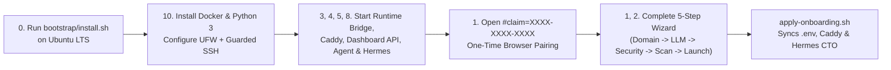
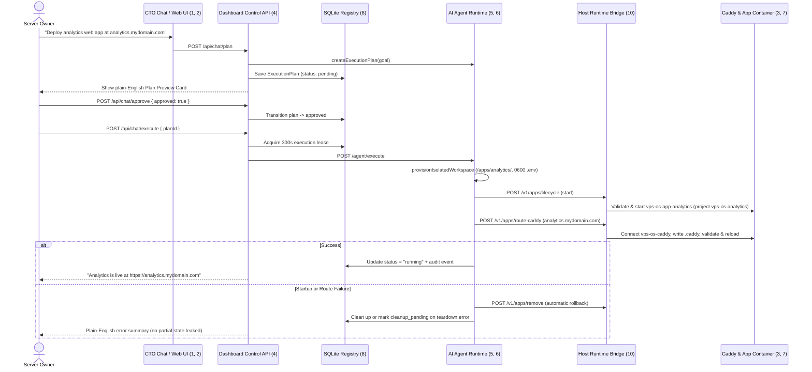
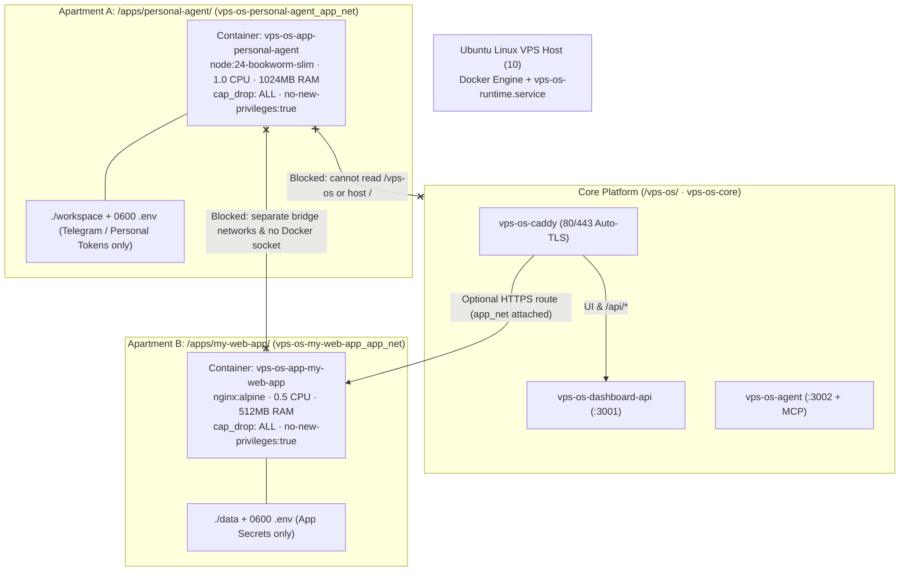

# Lifecycle Flows & Real-World Use Cases

This guide explains how all components of the **VPS OS Framework** work together in plain language—from first-time server setup to running an autonomous personal agent alongside separate web applications.

---

## Core Lifecycle Flows

### Flow A: First-Time Provisioning (`0` -> `10` -> `3`, `4`, `5`, `8` -> `1`, `2`)

**Goal:** Turn a blank Ubuntu LTS VPS into a browser-managed server appliance in one step.



1. **Bare Ubuntu VPS Entry (`0`):** An operator runs the one-shot installer from [`bootstrap/install.sh`](../bootstrap/install.sh) (`curl -fsSL ... | sudo bash`) on a fresh Ubuntu 22.04/24.04 LTS VPS.
2. **Host & Docker Setup (`10`):** The bootstrapper configures `ufw` (allowing only the detected SSH port, `80/tcp`, and `443/tcp`), applies SSH hardening only if public SSH keys exist, installs Docker Engine + Python 3, starts `vps-os-runtime.service`, and prints a one-time `#claim=` setup URL.
3. **Core Stack Bring-Up (`3`, `4`, `5`, `8`):** Launches **Caddy (`3`)**, **Dashboard Control API (`4`)**, **VPS OS Agent (`5`)**, and **SQLite WAL Registry (`8`)**, then installs **Hermes Agent** with the pre-seeded CTO pack (`SOUL.md`, `memories/`, `skills/vps-os-*`) and `vps-os-hermes-cto.service` (see [Hermes CTO Architecture & Onboarding](hermes-cto-onboarding.md)).
4. **Browser First-Boot Setup Wizard (`1`, `2`):** Open the printed setup link in a browser to claim the server (24h expiry, 5-attempt lockout), verify DNS for automatic HTTPS (or start in `:80` IP mode), connect and test your AI provider key, set a memorable dashboard passphrase, and run your initial baseline server scan—no further SSH setup required.

---

### Flow B: Conversational App Deployment (`2` -> `4` -> `5` -> `6` -> `10` -> `7`, `3`, `8`)

**Goal:** Install and launch a new application just by asking for it in plain English, with explicit approval and automatic rollback on failure.



1. **User Request (`2` -> `4` -> `5`):** In **Natural-Language CTO Chat (`2`)**, you ask: *"Deploy analytics web app at `analytics.mydomain.com`."* The Control API (`4`) calls `createExecutionPlan()` and stores a `pending` plan (`8`).
2. **Plan & Approval (`1` -> `4` -> `8`):** You inspect the structured step list (folder `/apps/analytics`, port `80`, domain route) and click **Approve** (`POST /api/chat/approve`).
3. **Isolated Install (`6` -> `9` -> `10` -> `7`):** On execution (`POST /api/chat/execute`), `vps-os-agent` acquires a cross-process lease, provisions `/apps/analytics/` with `docker-compose.yml` and `0600` `.env` (`6`, `9`), and asks the **Host Runtime Bridge (`10`)** to validate Compose and start the container (`7`).
4. **Route & Register (`3` & `8`):** The Runtime Bridge attaches `vps-os-caddy` to `vps-os-analytics_app_net`, writes `/vps-os/caddy/apps.d/analytics.caddy`, reloads Caddy (`3`), and marks the app `running` in SQLite (`8`). If any startup or routing step fails, `deployWorkloadWithBridge` rolls back automatically.

---

### Flow C: Live Monitoring & Safe Recovery (`1` -> `3` -> `4` -> `8`, `10`)

**Goal:** Keep full visibility and one-click control without touching a terminal.

1. **Dashboard Polling (`1` -> `3` -> `4`):** Opening the **Management Web UI (`1`)** queries the **Dashboard Control API (`4`)** over HTTPS.
2. **State + Live Metrics (`4` -> `8`, `10`):** The API combines host telemetry (`cpuCount`, `loadAverage1m`, `memoryUsagePercent`, `disk`, `uptimeSeconds`) with live batch container status sync (`/v1/apps/statuses`) via the Host Runtime Bridge (`10`).
3. **Safe Operations:** From the UI you can **Start**, **Stop**, **Restart**, inspect **secret-redacted logs** (`GET /api/apps/:slug/logs`), review the immutable audit log, or ask the **CTO Agent (`5`)** to diagnose a failing container using `read_app_logs` and `vps-os-diagnose-and-recover`.

---

## Featured Use Case: Personal Life Agent Container vs. Separate App Container

A common question is whether you can run **two very different workloads on the same VPS**:
1. A **Personal Life AI Agent** (`templates/personal-agent/`) that needs **full terminal access** inside its workspace to run scripts, install packages, and automate tasks.
2. A **Separate App** (`templates/web-app/`, such as a client portal, SaaS, or finance tool) that must remain stable, fast, and untouched.

### How the "Locked Apartment" Isolation Model Solves This



Each installation lives in its own dedicated directory and container boundary—like separate locked apartments inside the same building:

```text
Ubuntu Linux VPS Host (10)
├── /vps-os/                    # Core Platform (Proxy 3, Dashboard 4, Agent 5, Registry 8)
├── /apps/personal-agent/       # Apartment A: Personal Life Agent
│   ├── docker-compose.yml      # 1.0 CPU, 1024m RAM, cap_drop: ALL, isolated app_net
│   ├── .env                    # 0600: ONLY personal-agent tokens (Telegram, LLM, Calendar)
│   └── workspace/              # Full Linux shell & persistent files for the agent
└── /apps/my-web-app/           # Apartment B: Separate Application
    ├── docker-compose.yml      # 0.5 CPU, 512m RAM, separate app_net, healthcheck
    ├── .env                    # 0600: ONLY app runtime config/secrets
    └── data/                   # Persistent app static files / data
```

#### Why This Works Safely

- **Full Power *Inside* `/apps/personal-agent/`:** Inside its container, your Personal Agent has a complete `node:24-bookworm-slim` userland (`bash`, Node, file tools) scoped to `/workspace`. It can write scripts, organize files, and execute automation freely inside `workspace/`.
- **Hard Walls *Outside* Its Container:** It has **no access** to the host Ubuntu OS, no access to `/var/run/docker.sock`, no `cap_drop` exceptions, and no visibility into `/apps/my-web-app/`. It cannot read your other app's `.env` secrets or touch its data.
- **Resource Protection:** CPU (`1.0` / `0.5`) and memory (`1024m` / `512m`) caps guarantee that a heavy automation script in Apartment A cannot starve Apartment B.
- **One-Click Recovery:** If Apartment A ever misbehaves, you can stop, restart, or rebuild `/apps/personal-agent/` from the Management Dashboard without interrupting `/apps/my-web-app/`.

---

### End-to-End Walkthrough: Everyday Life with This Setup

1. **Setup via CTO Chat:** You tell the CTO Agent:
   - *"Create a personal life agent in its own isolated folder with Telegram access"*
   - *"Deploy my web app at `app.mydomain.com`"*
2. **What You Can Ask Your Personal Agent Every Day:**
   - **File & Data Automation:** *"Clean these monthly expense CSVs and send me a breakdown."* -> Runs a script inside `/apps/personal-agent/workspace/` and returns the summary.
   - **Scheduled Monitors:** *"Check this API/site every morning at 8am and message me if a slot opens."* -> Runs on a schedule inside its own sandbox.
   - **Personal Knowledge Base:** *"Organize my saved PDFs, notes, and reading summaries."* -> Maintains structured markdown/SQLite indexes in `workspace/`.
3. **What You See in the Management Dashboard:**
   - Two clean cards—**Personal Life Agent** (`personal-agent`) and **My Web App** (`web-app`)—showing live CPU/RAM limits, `running` status, secret-redacted logs, and one-click **Start / Stop / Restart** controls.
