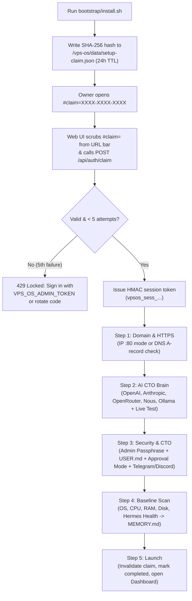
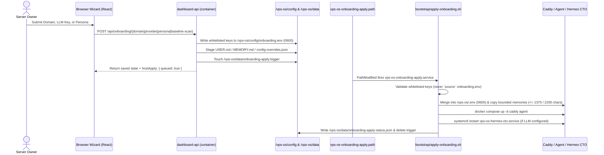

# Getting Started, Installation & Onboarding

This guide covers everything needed to turn a fresh **Ubuntu LTS VPS** into a browser-managed **VPS OS** appliance, complete the **5-step Browser First-Boot Wizard**, or run and verify the monorepo locally for development.

---

## 1. Production Setup on Ubuntu LTS

### Prerequisites

- A fresh **Ubuntu 22.04 LTS** or **Ubuntu 24.04 LTS** VPS with root (`sudo`) access.
- Ports **80/tcp**, **443/tcp**, and your **SSH port** reachable on your cloud firewall.
- *(Optional for HTTPS)* A domain or subdomain whose `A` record points to your VPS public IP (you can also start in IP-only `:80` mode and bind a domain later in the browser wizard).

### One-Shot Installation

Run the idempotent bootstrapper from [`bootstrap/install.sh`](../bootstrap/install.sh):

```bash
curl -fsSL https://raw.githubusercontent.com/diegosg-dev/vps-os-framework/main/bootstrap/install.sh | sudo bash
```

Or from a cloned checkout:

```bash
git clone https://github.com/diegosg-dev/vps-os-framework.git
cd vps-os-framework
sudo bash bootstrap/install.sh
```

#### Common CLI Flags & Environment Overrides

| Option / Env Var | Default | Purpose |
|---|---|---|
| `--domain <host>` | *(interactive prompt or IP mode)* | Sets `VPS_OS_DOMAIN` & `VPS_OS_SITE_ADDRESS` and checks DNS `A` resolution |
| `--email <email>` | `admin@example.com` *(effective Caddyfile fallback)* | Sets `VPS_OS_ACME_EMAIL` for Let's Encrypt TLS notifications |
| `--llm-provider <name>` | `openai` | Pre-seeds `LLM_PROVIDER` (`openai \| anthropic \| openrouter \| nous \| ollama`) |
| `--llm-model <model>` | `gpt-4.1` | Pre-seeds `LLM_MODEL` |
| `--llm-key <key>` | *(empty)* | Pre-seeds `LLM_API_KEY` so Hermes CTO auto-starts immediately |
| `--rotate-setup-code` | `false` | Generates a fresh single-use 12-char setup pairing code (`ABCD-EFGH-JKLM`) |
| `--non-interactive`, `-y` | `false` | Skips interactive domain/email prompts (ideal for `cloud-init` or CI) |
| `--force` | `false` | Overwrites preserved `Caddyfile`, `config.yaml`, memories, and systemd unit files |
| `INSTALL_HERMES=false` | `true` | Skips installing the host Hermes Agent CLI and `vps-os-hermes-cto.service` |
| `VPS_OS_ROOT` / `APPS_ROOT` | `/vps-os` / `/apps` | Override core platform root or isolated workload root |

### What `bootstrap/install.sh` Provisions

1. **System & Runtime Dependencies:** Installs Docker Engine + Compose v2 (`docker-ce`, `docker-compose-plugin`) and `python3` if missing.
2. **Non-Destructive SSH & Firewall Hardening:**
   - Detects your active SSH port from `/etc/ssh/sshd_config` and configures `ufw` to allow only that SSH port plus `80/tcp` and `443/tcp`.
   - Applies `/etc/ssh/sshd_config.d/99-vps-os-hardening.conf` (`PermitRootLogin prohibit-password`, `PasswordAuthentication no`) **only** when valid SSH public keys exist in `/root/.ssh/authorized_keys` or `${SUDO_USER}`'s `authorized_keys` (preventing lockout on password-only VPSs).
3. **Directory & Secret Initialization:**
   - Creates `/vps-os/{data,config,run,caddy/apps.d,hermes}` and `/apps`.
   - Generates random 32-byte hex secrets for `VPS_OS_ADMIN_TOKEN`, `VPS_OS_RUNTIME_TOKEN`, and `HERMES_API_SERVER_KEY` in `/vps-os/.env` (`chmod 600`).
   - Writes `/vps-os/runtime-bridge.env` (`chmod 600`, root-owned) containing **only** `VPS_OS_RUNTIME_TOKEN`.
   - Generates a 12-character one-time setup code and stores only its **SHA-256 hash** (24-hour expiry, 5-attempt lockout) in `/vps-os/data/setup-claim.json`.
4. **Systemd Services & Core Containers:**
   - Starts `vps-os-runtime.service` (`bootstrap/runtime-bridge.py` on `/vps-os/run/runtime.sock`).
   - Builds and starts `vps-os-caddy`, `vps-os-dashboard-api`, and `vps-os-agent` on the isolated `vps-os-core` bridge network.
   - Installs Hermes Agent (`--non-interactive --skip-browser --skip-computer-use`), syncs `agent/hermes/` (`SOUL.md`, `skills/vps-os-*`, seed `MEMORY.md` / `USER.md`, rendered `config.yaml`), and enables `vps-os-hermes-cto.service` (`127.0.0.1:8642`).
   - Enables `vps-os-onboarding-apply.path` + `vps-os-onboarding-apply.service` to safely sync browser wizard changes onto the host.

---

## 2. First-Boot Claim & 5-Step Browser Wizard

At the end of installation, the script prints a one-click browser link:

```text
Dashboard URL : http://<PUBLIC_IP>/   (or https://<DOMAIN>/)
Setup Code    : XXXX-XXXX-XXXX (single-use, expires in 24h)
One-Click Link: http://<PUBLIC_IP>/#claim=XXXX-XXXX-XXXX
```

### Bootstrap-to-Dashboard State Flow



### How Browser Changes Reach the Host Safely

Because `vps-os-dashboard-api` runs unprivileged (`USER node`, `cap_drop: ALL`, no Docker socket), it never edits `/vps-os/.env` or restarts `systemd` units directly. Instead, it writes staged configuration files and touches a trigger file watched by `systemd`:



---

## 3. Local Development & Verification

### Requirements

- **Node.js `>=24.0.0`** (with Corepack enabled for `pnpm@10.0.0`)
- **Python 3** (for running `bootstrap/runtime-bridge.py` tests and syntax checks)
- **Bash** (optional on Windows via Git Bash; used for `bootstrap/*.sh` syntax/guardrail tests)

### Workspace Commands

Run all commands from the repository root:

```bash
# Install workspace dependencies
corepack pnpm install --frozen-lockfile

# Build all packages (shared, agent, dashboard/api, dashboard/web, tests)
corepack pnpm build

# Typecheck all TypeScript projects
corepack pnpm typecheck

# Run the full automated test suite (29 tests across safety, agent, API, onboarding, runtime bridge, and templates/bootstrap)
corepack pnpm test

# Full verification gate (build + typecheck + test)
corepack pnpm verify
```

### Running Services Individually for Local Development

1. **Create local state directories and set environment variables** (never commit `.env` files):

   ```bash
   mkdir -p ./.local-dev/apps ./.local-dev/caddy
   export VPS_OS_ADMIN_TOKEN="dev-local-admin-token-at-least-16-chars"
   export VPS_OS_REGISTRY_DB="./.local-dev/registry.db"
   export VPS_OS_APPS_ROOT="./.local-dev/apps"
   export VPS_OS_AGENT_URL="http://127.0.0.1:3002"
   ```

2. **Optional local Runtime Bridge over loopback TCP** (for testing lifecycle/log routes without root or a Linux Unix socket):

   ```bash
   python3 bootstrap/runtime-bridge.py --tcp 127.0.0.1:8765 --allow-unauthenticated --apps-root ./.local-dev/apps --caddy-apps-dir ./.local-dev/caddy
   export VPS_OS_RUNTIME_URL="http://127.0.0.1:8765"
   ```

3. **Start the Agent HTTP Server (`:3002`) and Dashboard API (`:3001`):**

   ```bash
   node agent/dist/index.js
   node dashboard/api/dist/index.js
   ```

4. **Start the Vite Frontend Dev Server (optional hot reload):**

   ```bash
   corepack pnpm --filter @vps-os/dashboard-web dev
   ```

---

## Next Steps

- Review **[Lifecycle Flows & Use Cases](flows-and-use-cases.md)** to see how everyday deployments and Personal Agent isolation work.
- Inspect **[Runtime Bridge & Security](runtime-and-security.md)** for the full security and Compose isolation model.
- Browse **[API, Agent & Registry Reference](api-and-agent-reference.md)** for endpoint schemas, MCP tools, and SQLite tables.
