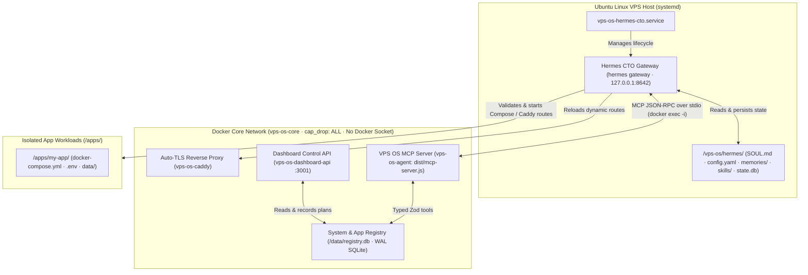
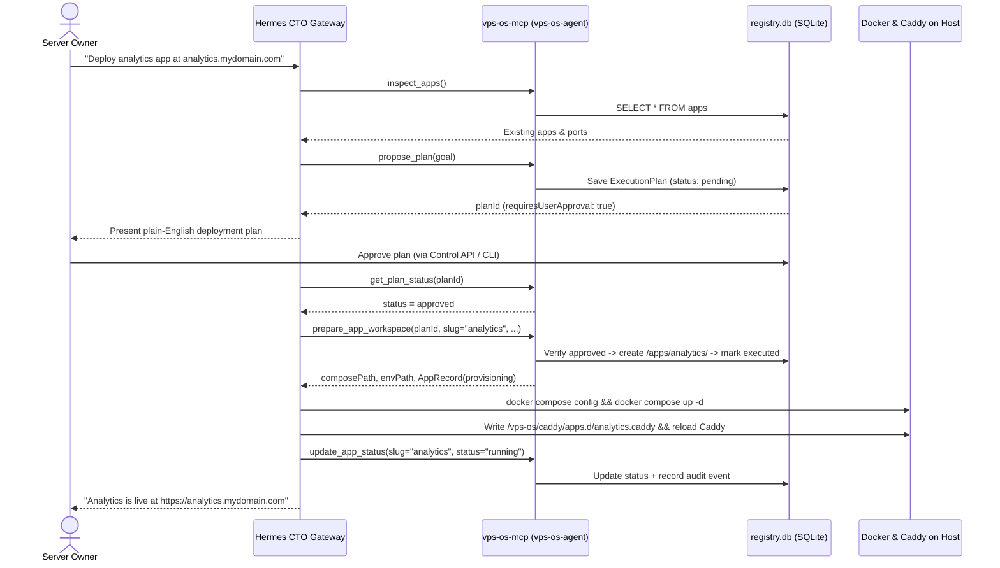
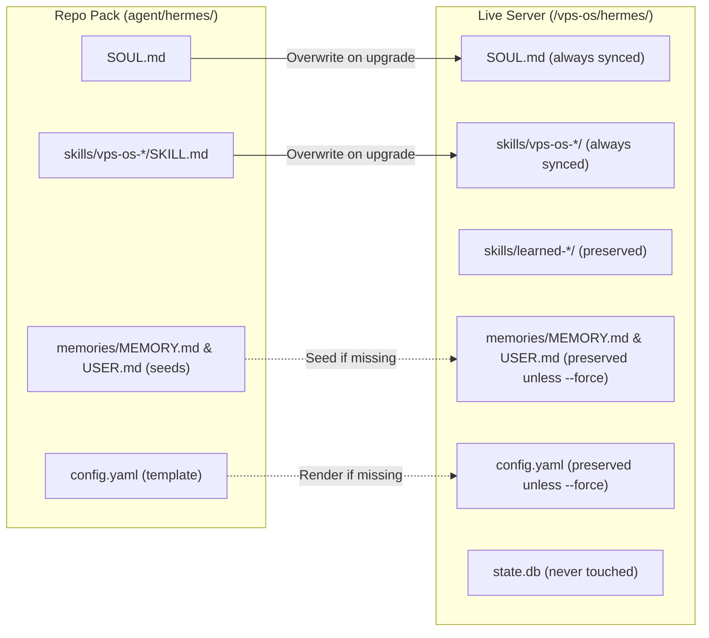

# Hermes CTO Agent — Architecture, Onboarding & Phase 2 Roadmap

This document explains how **NousResearch Hermes Agent** acts as the **Autonomous AI CTO / Sysadmin / Dev (`Step 5`)** for the VPS OS Framework, how **Phase 1** provisions it automatically during server bootstrap, and what is planned for **Phase 2 (Browser First-Boot Setup Wizard)**.

---

## 1. Why Hermes Runs as the Host CTO (and Bridges via MCP)

The CTO Agent manages host-level Docker Compose stacks under `/apps/<slug>`, Caddy route files under `/vps-os/caddy/apps.d/`, and Ubuntu health diagnostics—while all core containers (`vps-os-caddy`, `vps-os-dashboard-api`, `vps-os-agent`) strictly drop capabilities (`cap_drop: ALL`) and **never mount `/var/run/docker.sock`**.

To preserve container isolation while giving the CTO real sysadmin capabilities:

1. **`hermes gateway` runs on the Ubuntu host** as a `systemd` service (`vps-os-hermes-cto.service`) bound to loopback (`127.0.0.1:8642`).
2. **Typed VPS OS state and safety gates stay in TypeScript** inside the hardened `vps-os-agent` container (`agent/dist/mcp-server.js`).
3. **Hermes connects to `vps-os-mcp` over `stdio`** (`docker exec -i vps-os-agent node /srv/vps-os/agent/dist/mcp-server.js`), so the Ubuntu host needs no standalone Node.js runtime and all registry/workspace mutations pass through Zod + SQLite + `ExecutionPlan` approval checks.

### Runtime & Isolation Topology (Phase 1)

---

## 2. Hermes CTO Subsystems in `agent/hermes/`

All CTO defaults live in [`agent/hermes/`](../agent/hermes/) and are validated by `validateHermesPack()` in [`agent/src/hermes-pack.ts`](../agent/src/hermes-pack.ts).

### A. Personality (`SOUL.md` — Prompt Slot #1)

[`agent/hermes/SOUL.md`](../agent/hermes/SOUL.md) is injected first into every Hermes session and cron run. It defines **who Hermes is for the owner** — a calm, honest, plain-English CTO persona layered in as *"Who You Are"* and *"How You Communicate"* — on top of six non-negotiable CTO behaviors:

1. **Plain English first** for non-Linux, non-coding server owners.
2. **Typed VPS OS MCP tools first** before touching files or containers.
3. **Approval before mutation** (no destructive host actions or unapproved `/apps/<slug>` provisioning).
4. **Locked Apartment isolation** (`cap_drop: ALL`, `no-new-privileges:true`, CPU/RAM limits, no Docker socket mounts).
5. **Secret hygiene** (never print or commit `.env`, API keys, or private keys).
6. **Verify before reporting done** (`docker compose config`, healthcheck status, Caddy validation, and final registry update).

### B. Curated Memory & Transcript Recall (`memories/` + `state.db`)

Hermes uses a layered memory design seeded with bounded starter files:

| Layer | File / Store | Limit | Behavior |
|---|---|---|---|
| **Server Facts** | [`memories/MEMORY.md`](../agent/hermes/memories/MEMORY.md) | `2,200` chars (`HERMES_MEMORY_MAX_CHARS`) | Frozen prompt snapshot of `/vps-os`, `/apps`, Caddy layout, and baseline host specs. |
| **Owner Profile** | [`memories/USER.md`](../agent/hermes/memories/USER.md) | `1,375` chars (`HERMES_USER_MAX_CHARS`) | Frozen prompt snapshot of communication level and approval preferences. |
| **Session History** | `/vps-os/hermes/state.db` (`FTS5`) | Indexed history | Full-text recall across past CLI, gateway, and troubleshooting transcripts via `session_search`. |
| **Compaction** | `config.yaml` (`compression.threshold: 0.75`) | Context-driven | Summarizes older turns automatically during long multi-step debugging sessions. |

### C. Pre-Seeded CTO Skills (`skills/vps-os-*/SKILL.md`)

Hermes loads only skill names and descriptions at startup (progressive disclosure) and pulls full instructions on demand:

| Skill | Responsibility | Source |
|---|---|---|
| `vps-os-deploy-app` | End-to-end isolated app provisioning, Compose validation, Caddy binding, and `running` status update | [`SKILL.md`](../agent/hermes/skills/vps-os-deploy-app/SKILL.md) |
| `vps-os-diagnose-and-recover` | Read-only-first diagnostics (`df`, `free`, `docker compose ps`, redacted logs) and safe recovery | [`SKILL.md`](../agent/hermes/skills/vps-os-diagnose-and-recover/SKILL.md) |
| `vps-os-domain-tls` | Pre-flight DNS verification before writing `/vps-os/caddy/apps.d/<slug>.caddy` to avoid ACME rate limits | [`SKILL.md`](../agent/hermes/skills/vps-os-domain-tls/SKILL.md) |
| `vps-os-backup-cron` | Hot SQLite backups (`sqlite3 .backup`) and `/apps/*/data` snapshots via Hermes `cronjob` | [`SKILL.md`](../agent/hermes/skills/vps-os-backup-cron/SKILL.md) |
| `vps-os-secrets-hygiene` | `0600` scoped `.env` rules and secret redaction across logs, chat, and `MEMORY.md` | [`SKILL.md`](../agent/hermes/skills/vps-os-secrets-hygiene/SKILL.md) |

In addition, Hermes can author new custom skills under `/vps-os/hermes/skills/` (e.g., `learned-*`) via `skill_manage` when it solves server-specific workflows.

### D. Typed VPS OS MCP Toolset (`agent/src/mcp-server.ts`)

[`createMcpRequestHandler`](../agent/src/mcp-server.ts) exposes [`createAgentToolset`](../agent/src/tools.ts) over MCP JSON-RPC 2.0 (`initialize`, `ping`, `tools/list`, `tools/call`) with recursive leaf-string secret redaction (`redactJsonValue`) prior to JSON serialization:

| MCP Tool | Purpose | Approval / Safety Guard |
|---|---|---|
| `inspect_apps` | List registered apps, domains, ports, and resource limits | Read-only |
| `list_audit_events` | Inspect recent redacted audit trail entries | Read-only |
| `propose_plan` | Classify risk (`low` / `medium` / `high`) and persist an `ExecutionPlan` | Redacts secrets in goal |
| `get_plan_status` | Check whether a pending `ExecutionPlan` has been approved or rejected | Read-only |
| `prepare_app_workspace` | Create `/apps/<slug>`, Compose file, `.env.example`, `.env` (`0600`), and `provisioning` record | **Blocked unless plan status is `approved`**; marks plan `executed` to prevent replay |
| `update_app_status` | Record final lifecycle status (`provisioning`, `running`, `stopped`, `error`) + audit event | Validates slug (`validateAppSlug`) and status (`AppStatusSchema`) |

### Approval-Gated Deployment Flow

---

## 3. Phase 1 Bootstrap & Upgrade Safety (`bootstrap/install.sh`)

During [`bootstrap/install.sh`](../bootstrap/install.sh):

1. Creates `/vps-os/data`, `/vps-os/caddy/apps.d`, `/apps`, and `${HERMES_HOME}` (`/vps-os/hermes/{memories,skills}`).
2. Generates random 32-byte hex secrets for `VPS_OS_ADMIN_TOKEN` and `HERMES_API_SERVER_KEY` in `/vps-os/.env` (`chmod 600`).
3. Brings up the core Docker Compose stack (`vps-os-caddy`, `vps-os-dashboard-api`, `vps-os-agent`).
4. Installs Hermes Agent (`ensure_hermes`) unless `INSTALL_HERMES=false`.
5. Runs `sync_hermes_pack` *after* installation so VPS OS defaults take precedence over upstream installer files.
6. Writes and enables `/etc/systemd/system/vps-os-hermes-cto.service` (`API_SERVER_ENABLED=true`, `127.0.0.1:8642`). The service auto-starts immediately if `LLM_API_KEY` is configured, or waits cleanly until the key is set.

### Upgrade Ownership Model

---

## 4. Phase 2: Browser First-Boot Setup Wizard (Implemented)

Phase 2 moves final setup out of SSH into the Management Web UI (`dashboard/web/` + `dashboard/api/`) while preserving strict container isolation (`cap_drop: ALL`, no Docker socket mount):

1. **One-Time Bootstrap Claim & Passphrase Login:**
   - [`bootstrap/install.sh`](../bootstrap/install.sh) prints a single-use setup pairing code (storing only its SHA-256 hash and 24-hour expiry in `/vps-os/data/setup-claim.json`, locked after 5 failed attempts) plus a `#claim=` link that the browser consumes and scrubs from the URL immediately.
   - `POST /api/auth/claim` and `POST /api/auth/login` issue HMAC-signed session tokens (`vpsos_sess_...`) scoped to `session_epoch` in SQLite. Owners can configure a memorable Admin Passphrase (`scrypt`-hashed) during onboarding so they don't need to copy the raw 64-char `VPS_OS_ADMIN_TOKEN`.
2. **5-Step Browser First-Boot Wizard (`dashboard/web/src/components/OnboardingWizard.tsx`):**
   - **Step 1 — Domain & HTTPS:** Detects the server public IP, guides `A` record creation, verifies live DNS (`POST /api/onboarding/domain/verify`), or supports IP setup mode (`:80`) until DNS propagates.
   - **Step 2 — AI CTO Brain:** Connects OpenAI, Anthropic, OpenRouter, Nous Research, or local Ollama, tests connectivity (`POST /api/onboarding/provider/test`), and stores keys in `/vps-os/config/onboarding.env` (`0600`) without ever storing plaintext keys in SQLite or returning them to the browser.
   - **Step 3 — Security, Persona & Channels:** Sets an optional dashboard passphrase, updates bounded `USER.md` (`<= 1,375` chars) and `approvals.mode` (`manual` vs. `smart`), and accepts optional Telegram/Discord bot tokens.
   - **Step 4 — Baseline Server Scan:** Runs `POST /api/onboarding/baseline-scan`, inspects OS, CPU/RAM/disk, domain/TLS, and Hermes Gateway health, and updates `MEMORY.md` (`<= 2,200` chars).
   - **Step 5 — Launch:** Marks onboarding complete (`POST /api/onboarding/complete`), invalidates the one-time setup claim, and opens the Management Dashboard.
3. **Scoped Host Sync Bridge (`bootstrap/apply-onboarding.sh`):**
   - `dashboard-api` writes whitelisted keys to `/vps-os/config/onboarding.env` and stages Hermes memory/config overrides under `/vps-os/data/hermes-staging/`, then touches `/vps-os/data/onboarding-apply.trigger`.
   - `vps-os-onboarding-apply.path` + `vps-os-onboarding-apply.service` on the Ubuntu host invoke [`bootstrap/apply-onboarding.sh`](../bootstrap/apply-onboarding.sh), safely merging whitelisted keys into `/vps-os/.env`, reloading `caddy`/`agent`, and starting `vps-os-hermes-cto.service`.

---

## 5. Next Phase Roadmap — Live Hermes SSE Chat Bridge (Planned)

- Bridge `dashboard/api` (`/api/chat/*`) directly to Hermes Gateway's `/v1/responses` and `/v1/runs` SSE streams (using `HERMES_API_SERVER_KEY` and `X-Hermes-Session-Key`) for streaming multi-turn CTO execution inside the browser.
