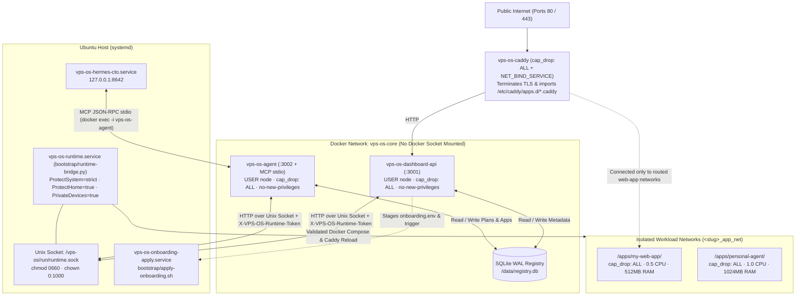
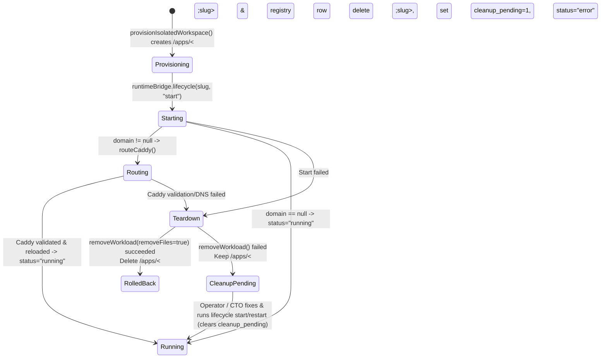

# Runtime Bridge, Isolation & Security Model

Security in the **VPS OS Framework** is enforced in code and container policy rather than relying solely on AI prompt instructions. Core control-plane containers never mount `/var/run/docker.sock`, every deployed workload runs inside a **"Locked Apartment"** boundary, and every boundary redacts secrets before storage or display.

---

## 1. Trust Boundaries & Zero-Docker-Socket Architecture

### Why This Design Prevents Container Escape

1. **No `/var/run/docker.sock` Inside Any Container:** Neither `vps-os-dashboard-api`, `vps-os-agent`, `vps-os-caddy`, nor any user workload can invoke arbitrary Docker daemon commands (such as mounting host `/` or starting `--privileged` containers).
2. **Narrow Unix Socket Bridge (`bootstrap/runtime-bridge.py`):** Host Docker Compose and Caddy operations flow exclusively through `/vps-os/run/runtime.sock` (`0660`, `chown 0:1000` matching container `USER node` UID `1000`), authenticated with `X-VPS-OS-Runtime-Token` (compared via `hmac.compare_digest`).
3. **Separate Root Token Scope:** `vps-os-runtime.service` loads `/vps-os/runtime-bridge.env` (`0600`, root-owned), which contains **only** `VPS_OS_RUNTIME_TOKEN`—never `VPS_OS_ADMIN_TOKEN` or `LLM_API_KEY`.
4. **Sanitized Docker Subprocess Environment:** `_sanitized_subprocess_env()` strips all secrets (including `VPS_OS_RUNTIME_TOKEN`) before calling `docker` or `docker compose`, forwarding only `PATH`, `HOME`, `DOCKER_HOST`, `DOCKER_CONFIG`, `TMPDIR`, `LANG`, and `LC_ALL`.
5. **Systemd Sandboxing:** `vps-os-runtime.service` enforces `NoNewPrivileges=true`, `ProtectSystem=strict`, `ProtectHome=true`, `PrivateDevices=true`, `PrivateTmp=true`, `RestrictAddressFamilies=AF_UNIX AF_INET AF_INET6`, and `ReadWritePaths=${VPS_OS_ROOT} ${APPS_ROOT} /run`.

---

## 2. TOCTOU-Safe Compose & Locked Apartment Policy

Before `vps-os-runtime` runs `docker compose` for any `/apps/<slug>`, `_validated_compose_context` performs strict structural validation and writes canonicalized copies to a **root-owned `0700` temporary directory** (`vps-os-<slug>-*`). Because UID `1000` inside `vps-os-agent` cannot modify files inside a root `0700` directory, this eliminates Time-of-Check to Time-of-Use (TOCTOU) swap attacks.

### Enforced Workload Rules

| Boundary | Enforcement Rule | Where Enforced |
|---|---|---|
| **Slug Naming** | `^[a-z0-9][a-z0-9-]{0,46}[a-z0-9]$` (`2–48` chars); rejects `core`, `vps-os`, `caddy`, `dashboard`, `agent`, `system`, `root`, `admin` | `validateAppSlug` (`safety.ts`) & `validate_slug` (`runtime-bridge.py`) |
| **Workspace Containment** | Resolves `/apps/<slug>` with `realpathSync` / `O_NOFOLLOW`; blocks `..` traversal and any symlinks | `resolveScopedAppDir` (`safety.ts`) & `resolve_scoped_app_dir` (`runtime-bridge.py`) |
| **Strict YAML Subset** | Rejects YAML anchors (`&`), aliases (`*`), custom tags (`!`), multi-document streams (`---`/`...`), and indentation tabs | `parse_simple_yaml` (`runtime-bridge.py`) |
| **Allowlisted Compose Keys** | Top-level: `services`, `networks` (`app_net` with `driver: bridge` only). Service keys: `image`, `container_name`, `restart`, `working_dir`, `command`, `init`, `env_file`, `environment`, `volumes`, `cpus`, `mem_limit`, `cap_drop`, `security_opt`, `networks`, `healthcheck` (1–4 services max) | `validate_and_render_compose` (`runtime-bridge.py`) |
| **Mandatory Privilege Drops** | Every service must include `cap_drop: [ALL]` and `security_opt: [no-new-privileges:true]` (never `unconfined`) | `validate_and_render_compose` (`runtime-bridge.py`) |
| **Volume Mount Sandbox** | Volumes may only mount relative `./data...` or `./workspace...` without `$`, `..`, or symlinks; rewritten to verified absolute paths | `RELATIVE_MOUNT_PATTERN` & `_validate_no_symlink_volume_source` |
| **Env & Interpolation Guard** | `.env` rejects `VPS_OS_*`, `DOCKER_*`, `LD_*`, `PATH`, `HOME`, `HOSTALIASES`, `IFS`, `ENV`, `BASH_ENV`; Compose only allows `${APP_IMAGE}`, `${APP_SLUG}`, `${APP_PORT}` | `parse_and_validate_env_file` & `_resolve_allowed_vars` |
| **Domain & Route Uniqueness** | Strict hostname regex, rejects IPs and Caddyfile syntax injection, verifies unique owner in SQLite & `/vps-os/caddy/apps.d/*.caddy`, validates Caddy config before reload | `validateDomain`, `idx_apps_unique_domain`, `route_caddy` |
| **SSRF Metadata Blocking** | Rejects embedded credentials (`user:pass@`) and cloud metadata hosts (`169.254.*`, `metadata.google.internal`, `metadata`, `100.100.100.200`) | `validateHttpBaseUrl` (`safety.ts`) |

---

## 3. Authentication, Sessions & API Hardening

### Auth Modes (`dashboard/api`)

1. **One-Time Setup Claim (`POST /api/auth/claim`):**
   - `bootstrap/install.sh` writes a SHA-256 hash (`codeHash`) to `/vps-os/data/setup-claim.json` with a 24-hour expiration.
   - Automatically locks permanently (`429`) after **5 failed verification attempts**, and is invalidated once onboarding completes (`POST /api/onboarding/complete`).
2. **Passphrase or Admin Token Login (`POST /api/auth/login`):**
   - **Admin Passphrase:** Hashed with a random 16-byte salt via `crypto.scryptSync(..., 64)` (`scrypt:<salt>:<hex>`) and verified with `crypto.timingSafeEqual`.
   - **Admin Token:** `VPS_OS_ADMIN_TOKEN` (minimum 16 chars; non-placeholder) compared via constant-time SHA-256 digest equality (`tokensEqual`).
3. **HMAC Session Tokens & Epoch Revocation:**
   - Successful claim or login issues `vpsos_sess_<base64url-payload>.<hmac-sha256-sig>` with a 24-hour TTL and `epoch` bound to `session_epoch` in SQLite.
   - Changing the admin passphrase (`POST /api/onboarding/security`) increments `session_epoch`, immediately invalidating all previously issued session tokens.

### Fail-Closed HTTP Controls

- **Fail-Closed Startup:** `createDashboardApp`, `createAgentHttpServer`, and `RuntimeService` fail closed when `adminToken` or `runtimeToken` is missing/empty (unless test-only `allowUnauthenticated` is explicitly enabled), while the CLI service entrypoints (`dashboard/api/src/index.ts`, `agent/src/index.ts`, and `runtime-bridge.py main()`) additionally reject `replace-with-*` placeholders and tokens shorter than `16` characters.
- **Public Route Allowlist:** Only `GET /api/health`, `GET /api/onboarding/status`, `POST /api/auth/claim`, and `POST /api/auth/login` bypass bearer/session token checks.
- **Rate Limiting & Body Caps:** Sliding-window rate limiter (default `120` requests per `60s`, bounded `10,000` key map, `trustProxy` defaults to `false` to prevent `X-Forwarded-For` spoofing) and `64 KiB` JSON body size cap (`413` on overflow).
- **Security Headers & CSP:** Every `/api/*` response sets `Cache-Control: no-store`, `X-Content-Type-Options: nosniff`, `X-Frame-Options: DENY`, and `Referrer-Policy: no-referrer`. Static SPA assets add `Content-Security-Policy: default-src 'self'; script-src 'self'; style-src 'self' 'unsafe-inline'; img-src 'self' data:; connect-src 'self'; frame-ancestors 'none'`.

---

## 4. Secret Redaction & Atomic Deployment Rollback

### Secret Redaction Boundaries

`redactSecrets()` (TypeScript in [`packages/shared/src/safety.ts`](../packages/shared/src/safety.ts)) and `redact_secrets()` (Python in [`bootstrap/runtime-bridge.py`](../bootstrap/runtime-bridge.py)) mask:
- PEM private key blocks (`-----BEGIN ... PRIVATE KEY-----`)
- `Bearer` / `Basic` authorization headers
- JSON fields and env/YAML keys matching `*(key|token|secret|password|passwd|pass|credential|auth)*`
- Known token prefixes (`sk-`, `sk-ant-`, `ghp_`/`gho_`/`ghu_`/`ghs_`/`ghr_`, `github_pat_`, `xox*-`, `AIza*`, Telegram bot tokens `\d{6,12}:AA...`)

In the MCP server (`agent/src/mcp-server.ts`), `redactJsonValue()` redacts every string leaf **before** JSON serialization so escaped quotes cannot break JSON framing.

### Safe Rollback & `cleanup_pending` State Machine

When deploying a new workload (`deployWorkloadWithBridge`), failures never leave orphaned containers or silently delete the Compose file needed to stop them:

